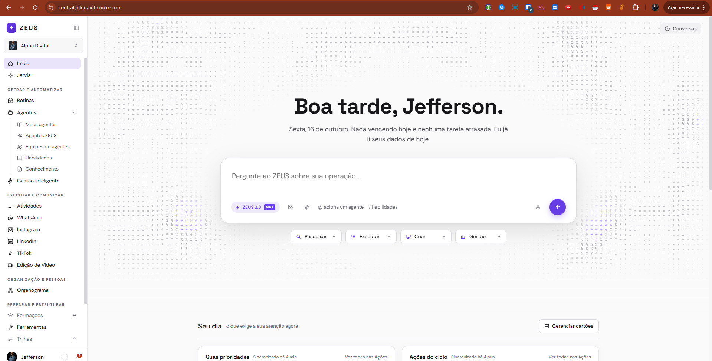
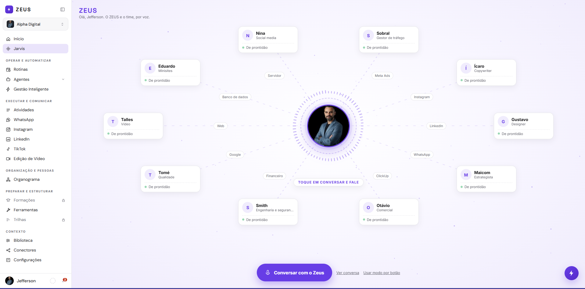
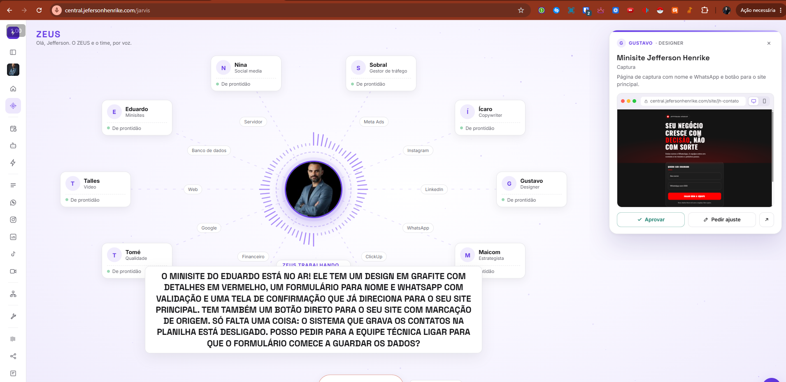
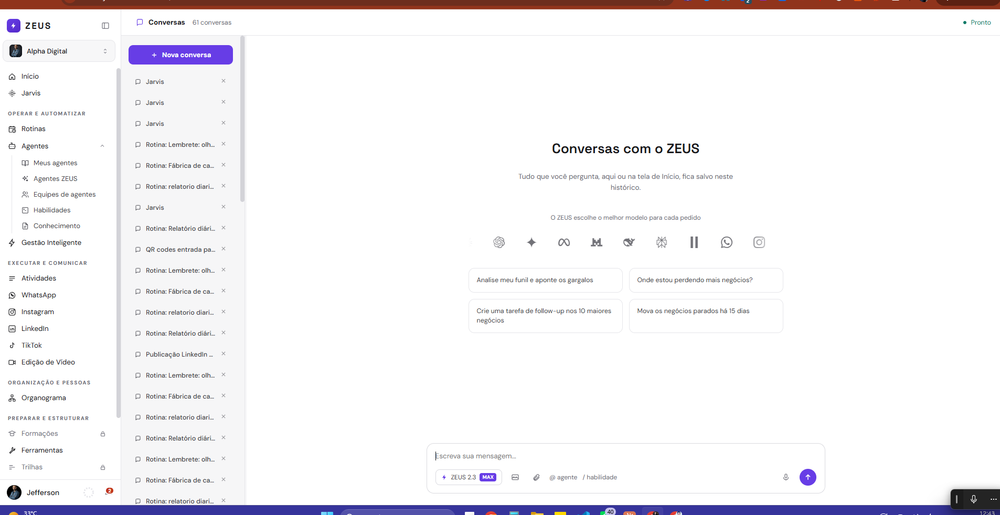

# Telas: Início, voz do ZEUS, Conversas, Edição de Vídeo e Memória

Documentação de leitura do código (estado em 16/10/2026). Fonte: `/opt/jeff-apps/jeff-central/public/index.html` (as telas são funções `render*()` do objeto `RENDERERS`, linha ~7504) e `/opt/jeff-apps/jeff-central/public/jarvis.js`. Números de linha são aproximados (o arquivo muda com frequência).

Convenções usadas abaixo:

- Constantes de estilo (`CFG_BOX`, `CFG_IN`, `HC_BOX`, `HC_H3`, `HC_MUTED`, `CHAT_ACT`, `CHAT_ICO_BTN`, `VIZ_FRAME`, `VIZ_SERIES`) estão descritas em `../componentes-e-telas.md`. Tokens `--jv-*` da tela de voz estão em `../voz-zeus.css`. Cores do selo (neutro, atenção, em andamento, ok, erro, marca) estão na tabela "Cores de estado" do mesmo `componentes-e-telas.md`.
- Roteamento: `state.screen` define a tela; `rotaFor()` (index.html ~337) gera a URL (`home` vira `/`, as demais viram `/<nome da tela>`); `VALID_SCREENS` (~375) lista as telas válidas.
- Celular: tudo que está dentro de `#main-slot` recebe as regras do bloco `@media (max-width:820px)` (index.html ~71 a 112): a barra lateral vira gaveta aberta pelo botão de menu da barra do topo `#mob-top` (56px), as margens de 40px viram 16px, grades com `minmax(23x+px` ou maior viram 1 coluna, tabelas rolam na horizontal, elementos `position:fixed` com `max-width` passam a `calc(100vw - 24px)`, altura `100vh` vira `calc(100dvh - 56px)`, o painel lateral de largura `flex:0 0 2xx` com `border-right` (lista de Conversas) vira faixa horizontal rolável no topo, e as dicas `@ aciona um agente` / `/ habilidades` (`[data-home-ins]`) somem (continuam funcionando ao digitar).
- Tema escuro: filtro `invert` aplicado na área principal (ver `componentes-e-telas.md`). Não existe paleta escura própria.

---

## Tela 1: Início



- **Rota e menu:** `/` (`state.screen = "home"`). Item "Início" no topo do menu lateral (`navItem("home", ICONS.home, "Início", ...)`, index.html ~1058). O mesmo item existe na lista curta do menu recolhido (~911).
- **Objetivo:** ponto de partida do dia: saudação, caixa de conversa com o ZEUS, atalhos de pedidos prontos e cartões "Seu dia" com o que exige atenção.
- **Origem:** `renderHome()` index.html ~2500. Auxiliares: `HOME_CATS` ~1109, `homeCatsHTML()` ~1261, `homeFxStart()` ~1281, `HOME_CARDS` ~2243, `homeCardsHTML()` ~2374, `hcManagerOpen()` ~2444, `diaLoad()` ~2210, `startChatFromHome()` ~10007.

### Layout

Fundo `#FAFAFA`, duas seções empilhadas dentro de um único contêiner:

1. **Seção hero** (`min-height: max(600px, calc(100vh - 130px))`, coluna, centralizada): bloco `data-home-hero` com largura máxima 960px, centralizado, com padding 40px 24px 30px.
   - Canvas `#home-fx` (animação de caracteres, ver abaixo) ocupa a seção inteira, atrás do conteúdo (`pointer-events:none`, começa com `opacity:0`).
   - Degradê de 120px na base da seção, de transparente a `#FAFAFA`.
   - Botão "Conversas" no canto superior direito (top 18px, right 22px; fundo `#F1F1F3`, ícone de relógio, `data-go="chat"`, título "Ver o histórico de conversas com o ZEUS"). Substitui a antiga aba Conversas do menu.
   - Saudação `h1` (Space Grotesk, `clamp(36px,4.8vw,58px)`, peso 700): "Boa madrugada" (antes das 5h), "Bom dia" (antes das 12h), "Boa tarde" (antes das 18h) ou "Boa noite", seguida de vírgula e do primeiro nome. Atualiza sozinha a cada 60 s sem recarregar (`setInterval`, ~2198).
   - Linha de apoio (17px, `#4A4A52`, máx. 600px): data por extenso em pt-BR ("Quinta, 16 de outubro", sem "-feira") + resumo de tarefas.
   - Caixa de conversa (formulário `.home-chat`): largura 100%, borda `#DADADF`, raio 22px, sombra grande, padding 28px 28px 20px. No foco a borda vira roxa (`rgba(103,61,230,0.55)`) com anel de 4px.
   - Atalhos por categoria (`homeCatsHTML()`): 4 botões centralizados abaixo da caixa.
2. **Seção "Seu dia"** (`#home-seu-dia`): largura máxima 1080px, centralizada. Cabeçalho com `h2` "Seu dia" (Space Grotesk 18px), legenda "o que exige a sua atenção agora" e botão "Gerenciar cartões" à direita. Abaixo, a grade de cartões `#home-cards`.

**Celular (abaixo de 820px):** regras globais (margens 16px, grade `minmax(340px,1fr)` dos cartões vira 1 coluna). As dicas `@`/`/` somem. O botão flutuante (`fab()`) não aparece na Início (a tela está na lista de ocultação).

### Componentes

- **Caixa de conversa:** `textarea` auto-crescente (`data-autogrow`, até ~8 linhas), placeholder "Pergunte ao ZEUS sobre sua operação...", fonte 19px, Enter envia e Shift+Enter quebra linha (`data-enter-envia`). Acima dela, chips de `@agente` e `/habilidade` (roxo `#673DE6` sobre `rgba(103,61,230,0.1)`, raio 20px, com X para remover) e chips de anexos (borda `#DADADF`, fundo `#F9F9FA`, raio 8px, máx. 260px).
- **Rodapé da caixa:** selo "ZEUS 2.3" com mini selo "MAX" (rótulo fixo, não é seletor), botão imagem (30px), botão clipe, dicas "@ aciona um agente" e "/ habilidades", espaçador, microfone (34px, redondo) e botão enviar (44px, redondo, roxo, seta para cima, sombra roxa).
- **Popup de menção** (`data-home-mention-pop`, 360px, máx. 320px de altura, raio 12px): cabeçalho "AGENTES" ou "HABILIDADES", até 8 itens com nome e subtítulo (categoria do agente, com " · catálogo" quando não está no workspace; grupo da habilidade). Navegação por setas, Enter ou Tab escolhem, Esc fecha, Backspace em campo vazio remove o último chip. Estado "Carregando..." enquanto `/api/agents` não chegou e "Nada encontrado para ..." quando a busca não acha.
- **Atalhos (`HOME_CATS`):** Pesquisar, Executar, Criar, Gestão. Cada um é um botão (min. 138px, borda `#DADADF`, raio 10px, ícone roxo, seta) que abre um popup de 310px com 4 pedidos prontos (clicar preenche e envia). Os dois primeiros abrem alinhados à esquerda, os outros à direita. Em "Executar" cada sugestão tem um ícone de agendar (`data-home-rotina`) que abre Rotinas já preenchida (`window.rotinaAbrirCom`). Rodapé de cada popup: link "Repetir automaticamente" (`data-go="rotinas"`).
- **Cartões "Seu dia"** (`HOME_CARDS`, `HC_BOX` e `HC_H3`; texto de apoio/vazio em `HC_MUTED`). Seis cartões, distribuídos alternadamente em 2 colunas (1º à esquerda, 2º à direita...), grade `repeat(auto-fit,minmax(340px,1fr))`, gap 18px:
  - `prioridades` "Suas prioridades": lista de tarefas que vencem hoje ou já venceram, com ponto colorido pelo prazo e link "Ver todas nas Ações".
  - `acoes` "Ações do ciclo": grupos "Atrasadas" (`#C0341C`), "Hoje" (`#673DE6`) e "A caminho" (`#3C3C44`, até 6), cada tarefa num mini cartão (`hcTarefa`) com botão "Abrir".
  - `time` "Meu time": barras horizontais (7px, fundo `#F1F1F3`, preenchimento `#673DE6`) de tarefas abertas por pessoa e total de atrasadas (vermelho `#C0341C` se houver, verde `#0F7A68` se zero).
  - `sinais` "Sinais dos motores": maior vazamento do funil de vendas, com botão "Analisar com o ZEUS" (preenche o chat) e "Abrir no Motor" (`motorVendas`).
  - `okrs` "OKRs": progresso do ciclo via `okrHomeCardHTML()` (okrs.js), botões "Analisar com o ZEUS" e "Fazer check-in".
  - `atualizacoes` "Atualizações": últimas movimentações das tarefas.
  - Selo de sincronização em vários cartões (`hcSync()`): "Sincronizado agora", "Sincronizado há N min" ou, em vermelho `#C0341C`, "Tarefas indisponíveis".
- **Painel "Gerenciar cartões"** (`hcManagerOpen()`, modal `#hc-manager`, 560px, raio 18px, fundo `#F7F7F8`): lista arrastável (`draggable`) com número de ordem, selo "MAIS IMPORTANTE" no primeiro visível, setas subir/descer, interruptor 38x22px (ligado `#673DE6`, desligado `#DADADF`), contador "N de 6 cartões visíveis", botões "Restaurar padrão" e "Concluir". Esc fecha.
- **Animação da home (`#home-fx`):** campo de caracteres ASCII (`" .·:-=+*%#@"`, células de 13px, fonte monoespaçada 11px) desenhado em canvas a ~20 fps. Fica só ao redor do bloco hero (elipse limpa em volta da saudação, caixa e atalhos, com margem de 40px x 34px) e some antes de chegar nos cartões. Caracteres fortes (n > 0.86) em roxo; os demais em cinza `rgba(112,112,124,...)`. Entra com fade de 0,9 s; sai (fade) quando a conversa começa (`_homeFxHold`) e volta ao retornar para a Início. Com `prefers-reduced-motion` desenha um único quadro parado. Para quando a aba está oculta.

### Estados

- **Carregando:** resumo "Lendo seus dados de hoje..."; cartões mostram `hcCarregando()` ("Carregando...").
- **Erro:** resumo "Não consegui ler suas tarefas agora."; cartões "Não consegui carregar os dados agora. Tento de novo em instantes."; cartões de tarefas com fonte caída mostram "Sem dados de tarefas no momento."
- **Vazio:** prioridades "Nada vencendo hoje. Dia limpo."; ações "Nenhuma tarefa aberta."; time "Ninguém com tarefa aberta."; atualizações "Nenhuma movimentação recente."; resumo "Nada vencendo hoje e nenhuma tarefa atrasada. Eu já li seus dados de hoje." Se todos os cartões estiverem ocultos: caixa tracejada "Todos os cartões estão ocultos. Use Gerenciar cartões...".
- **Com tarefas:** resumo "Você tem N para hoje e M atrasadas. Eu já li seus dados de hoje." (atrasadas em `#C0341C`).
- **Sem permissão / bloqueado:** não há estado específico na tela (a permissão vem do login da Central).
- Preferências dos cartões (ordem e ocultos) ficam no navegador (`localStorage` chave `zeus.homeCards`).

### Interações e API

- **Enviar** (Enter ou botão): `startChatFromHome(texto, tag, arquivos)`. Sem `@agente`: cria sessão (`POST /api/chat/sessions`), abre `/chat` (não abre mais o chat flutuante) e envia (`POST /api/chat/sessions/:sid/send`, multipart `text`, `skill`, `files`). Com `@agente`: abre `/agente/<id>` e envia por lá. Envio vazio (sem texto, agente ou anexo) é ignorado.
- **Anexos:** até 6 por mensagem (imagem ou "PDF, documento, planilha, áudio ou vídeo"); também aceita colar print com Ctrl+V (vira `print-HHMMSS.png`).
- **Microfone:** `micGravar` (ver tela Conversas) coloca o texto transcrito no campo para revisar.
- **Cartões:** clicar em tarefa abre dentro de Atividades (`data-abrir-tarefa`) ou `acoes`; links de rodapé usam `data-go`.
- **APIs:** `GET /api/home/dia` (atualiza a cada 5 min enquanto a Início está visível), `GET /api/okrs/resumo` (via okrs.js), `GET /api/agents` (popup de menção), `POST /api/chat/sessions`, `POST /api/chat/sessions/:sid/send`, `POST /api/chat/transcribe`.

---

## Tela 2: Voz do ZEUS ("Jarvis")



Falando, com entrega para aprovar (menu recolhido): legenda grande em caixa alta no rodapé, selo "ZEUS TRABALHANDO", cartão do agente à direita (Gustavo · Designer) com título, tipo, descrição, prévia em janela de navegador com alternância desktop/celular e os botões Aprovar, Pedir ajuste e abrir em nova aba.



- **Rota e menu:** `/jarvis` (`state.screen = "jarvis"`). Item do menu lateral com o rótulo **"Jarvis"** (logo abaixo de "Início", ícone `ICONS.jarvis`: círculo central, anel pontilhado e quatro marcas). O título dentro da tela é **"ZEUS"**.
- **Objetivo:** conversar por voz com o ZEUS e ver o time trabalhando ao vivo (cartões acendem, resultados viram painéis, ajustes são marcados na própria entrega).
- **Origem:** `public/jarvis.js` (923 linhas, módulo autônomo carregado depois do index: `<script src="/jarvis.js?v=12">`, index.html ~10696). Registra `RENDERERS.jarvis` (jarvis.js ~915). Funções principais: `pagina()` ~829, `cenaHTML()` ~232, `cartao()` ~218, `ilustracao()` ~201, `orbHTML()` ~244, `painelHTML()` ~379, `controlesHTML()` ~606, `statusTxt()` ~595, `abrirRevisao()` ~445, `animar()` ~883, CSS na constante `CSS` (~636 a 827; cópia em `../voz-zeus.css`). Servidor: `jeff-central/jarvis.js` (router montado em `/api/jarvis`).

### Layout (desktop, conforme o print)

Raiz `#jv-root`: `position:relative`, `height:100vh`, `min-height:560px`, `overflow:hidden`, fundo `--jv-fundo` (degradê radial branco para lilás). Camadas, de trás para frente:

1. **Canvas `#jv-fundo`:** 70 partículas roxas subindo devagar (cor `--jv-particula`).
2. **Cabeçalho (canto superior esquerdo, 24px / 20px):** "ZEUS" (Space Grotesk 22px, peso 700, espaçamento .08em, `--jv-roxo`) e a linha "Olá, <primeiro nome>. O ZEUS e o time, por voz." (12px, `--jv-sub`).
3. **Palco `#jv-palco`** (ocupa tudo; com painéis de resultado abertos recebe `.jv-estreito` e `right:400px`, com transição de .55 s) e dentro dele:
   - **Cena `#jv-cena`** (topo a 120px acima da base): SVG `viewBox 0 0 100 100` com as 10 linhas do centro até cada cartão, os rótulos de fontes de dados e os 10 cartões do time, todos posicionados em porcentagem. Os cartões ficam numa elipse (raio 38% x 36%, começando pouco antes do topo); as fontes ficam numa elipse interna (raio 21% x 23%, 12 lugares menos o de cima e o de baixo, que ficam livres para o status).
   - **Orbe central** (300x300px): foto do usuário (`meFoto()`; sem foto, ícone de raio roxo) num círculo com borda roxa de 3px, anel pontilhado girando (18 s) e canvas `#jv-anel` com 72 barras radiais que reagem ao áudio.
   - **Status `#jv-status`** (pílula abaixo do orbe, `top: calc(50% + 112px)`): texto em caixa alta, 11.5px, peso 700, roxo, fundo `--jv-card`, borda `--jv-borda`. No print: "TOQUE EM CONVERSAR E FALE".
   - **Legenda `#jv-legenda`** (centralizada, 132px acima da base, máx. 820px): caixa branca com a frase sendo falada (Space Grotesk 21px, peso 700; números e valores em R$ ou % destacados em roxo) ou o bloco "Você disse" com a sua fala.
4. **Painéis de resultado `#jv-paineis`:** coluna à direita (`right:0`, rolável, sem barra), ver "Cartões de resultado".
5. **Histórico `#jv-hist-box`:** caixa flutuante (esquerda, 120px acima da base, máx. 380px x 45vh) com as últimas 20 falas ("Você" alinhado à direita, ZEUS à esquerda).
6. **Controles `#jv-controles`** (centralizados, 22px acima da base): ver "Controles".
7. **Camada de revisão `#jv-rev`** (modal sobre a tela, ver "Revisão e aprovação").

O botão flutuante do widget (raio roxo no canto inferior direito, visível no print) existe nesta tela (`fab()` só se oculta em chat, agente, equipe, home, motorExec, growthAgente e edicaoVideo).

### Cartões do time (`EQUIPE`, 10 cartões)

Nina (Social media), Sobral (Gestor de tráfego), Ícaro (Copywriter), Gustavo (Designer), Maicom (Estrategista), Otávio (Comercial), Smith (Engenharia e segurança), Tomé (Qualidade), Talles (Vídeo), Eduardo (Minisites).

Cartão `.jv-card`: 196px de largura (172px quando há painéis abertos), padding 10px 12px, raio 14px, fundo `--jv-card`, borda `--jv-borda`, sombra `--jv-sombra`. Conteúdo: avatar circular de 36px com a inicial (fundo `--jv-lilas`, letra roxa), nome (13.5px, peso 700) e função (11px, `--jv-sub`, uma linha com reticências), separador tracejado e linha de status com ponto de 7px.

### Rótulos de fontes de dados (`FONTES`, 10 chips)

Meta Ads, Instagram, LinkedIn, WhatsApp, ClickUp, Financeiro, Google, Web, Banco de dados, Servidor. Chip `.jv-fonte`: pílula de 11px, `--jv-sub` sobre `--jv-card` com borda `--jv-borda`. Acende (`.jv-fonte-on`: texto branco, fundo e borda `--jv-roxo`, brilho roxo) por 9 s quando o evento `acao` do chat traz `tipo: "fonte"` com aquela fonte em `quem` (ids: `meta`, `instagram`, `linkedin`, `whatsapp`, `clickup`, `financeiro`, `google`, `web`, `dados`, `servidor`). O WhatsApp também acende ao chegar o evento `entrega`.

### Estados da tela de voz

A tela tem dois modos (`J.modo`): **tempo real** (padrão, voz ElevenLabs) e **botão** (microfone manual).

**Modo tempo real (padrão):**

| Estado | Texto do status | Controles e visual |
|---|---|---|
| Ocioso | "Toque em conversar e fale" | Botão roxo "Conversar com o Zeus" (58px de altura, pílula, ícone de microfone, sombra roxa). Anel do orbe quase parado (ondulação leve). Todos os cartões "De prontidão" (ponto verde claro `#9AD8B4`), linhas pontilhadas finas `--jv-linha`. |
| Conectando | "Conectando..." | Botão desabilitado com opacidade .6 e texto de conexão. |
| Ouvindo | "Ouvindo, pode falar" | O botão vira "Encerrar conversa" (`.jv-btn-fim`: fundo branco, texto vermelho `#C0341C`, borda vermelha, ponto piscante `.jv-gravando`); aparece o botão "Silenciar microfone"/"Ativar microfone" (`SEC`). Anel reage ao microfone (`getInputByteFrequencyData`). A legenda mostra "Você disse" + sua fala. |
| Falando | "Falando" | Anel reage à saída de áudio; legenda mostra a frase atual da resposta. |
| Pensando (Zeus trabalhando) | "Zeus trabalhando: <status do stream>" ou "Zeus trabalhando..." | Ocorre enquanto o pedido da voz está na fila (`zeusOcupado`). Cartões acendem (ver abaixo). Em "Ver conversa" o pedido aparece como "→ Zeus: ...". |

Ao encerrar, `onDisconnect` volta ao ocioso. Há link "Ver conversa" / "Esconder conversa" (`LINK`: 12px, sublinhado, `--jv-sub`) e, quando não há conversa em andamento, "Usar modo por botão".

**Modo botão** (link "Usar modo por botão"; o link de volta é "Conversa em tempo real"):

| Estado | Texto do status |
|---|---|
| Ocioso | "Toque no microfone e fale" |
| Ouvindo | "Ouvindo..." (microfone 66px vira vermelho `#C0341C`, pulsa, ícone vira quadrado de parar; para sozinho com "Conversa contínua" após 1,3 s de silêncio depois que a pessoa começou a falar; limite de 60 s) |
| Transcrevendo | "Entendendo o que você disse..." |
| Pensando | "<status do stream>..." ou "Pensando..." |
| Falando | "Falando" (legenda frase a frase, no ritmo do áudio) |

Controles do modo botão: caixa "Conversa contínua", botão de microfone redondo, botão "Parar" (aparece durante transcrever, pensar e falar), campo de texto "ou escreva aqui..." (230px) e os links de histórico e modo.

### Agente trabalhando (o cartão acende)

O stream do chat (`GET /api/chat/sessions/:sid/stream`, sessão criada com `context: "jarvis"`) emite o evento `acao` com `{tipo: "agente"|"fonte", quem, label}`. Quando `tipo === "agente"` e `quem` é um dos 10 ids, o cartão entra em `trabalhando`. Ciclo visual de cada cartão (`estadoDe()`):

| Estado | Cartão | Linha até o centro | Rótulo do estado |
|---|---|---|---|
| Trabalhando | `.jv-on`: cresce 7%, borda de 2px `--jv-roxo`, sombra roxa forte, avatar com anel cônico girando, ponto roxo piscando, balão roxo acima com o `label` (ex.: "Anotando o briefing"), ilustração animada | `.jv-l-on`: roxa, tracejada, fluindo do ZEUS para o agente | "Trabalhando" |
| Entregando (3,5 s depois do fim) | `.jv-ent`: borda de 2px `--jv-roxo2`, balão "Entregando ao Zeus..." | `.jv-l-ent`: pacotes pontilhados indo do agente para o ZEUS | "Entregando" |
| Pronto | `.jv-ok`: borda `--jv-ok` (verde `#0F7A68`), balão verde "Pronto, passei pro Zeus" | `.jv-l-ok`: verde, fina, opacidade .6 | "Pronto" (some depois de 25 s) |
| De prontidão (padrão) | borda `--jv-borda` | `.jv-l` fina e pontilhada | "De prontidão" |

### Ilustrações por agente (mini cena de 56px, fundo `--jv-lilas`, só aparece em Trabalhando e Entregando, CSS puro)

- **Nina:** celular com feed de posts rolando e corações subindo.
- **Sobral:** barras crescendo e seta de tendência verde.
- **Ícaro:** linhas de texto sendo digitadas com cursor piscando.
- **Gustavo:** formas (círculo roxo, quadrado rosa `#E0457B`, triângulo) surgindo e traço de pincel.
- **Maicom:** alvo com anéis e flecha.
- **Otávio:** funil com gotas caindo e moeda "R$".
- **Smith:** blocos de código com recuos diferentes.
- **Tomé:** lista de verificação com "✓" aparecendo em sequência.
- **Talles:** rolo de filme, botão play e barra de progresso.
- **Eduardo:** wireframe de site (cabeçalho, duas colunas, rodapé).

### Cartões de resultado (painéis)

Coluna à direita `#jv-paineis` (painel de 360px, raio 20px, sombra grande, faixa superior de 4px em degradê roxo, entra deslizando). Máximo de 5 (`MAX_PAINEIS`); o mais novo fica aberto, os anteriores viram faixas minimizadas (`.jv-painel-min`, clicar reabre) e o link `.jv-mais` ("Ver N resultado(s) anterior(es)" / "Esconder anteriores") expande todos. Topo do painel: avatar + nome do agente + função em caixa alta roxa, chip "Versão N" (quando o mesmo site ou arte volta atualizado, `chave` igual) e X de fechar. Abaixo, título (Space Grotesk 18px) e período. Painéis são atualizados no lugar (propriedade `v`) para os números não recomeçarem a contar e o site não recarregar. Tipos de bloco (`RE_BLOCO`):

- **`zeus-kpi`:** número principal grande (34px, contagem animada de 0.9 s que preserva "R$", "%" e separadores pt-BR) com selo de variação (verde `#0F7A68` se sobe, vermelho `#C0341C` se cai) e grade 2 colunas de até 8 números menores (fundo `--jv-lilas`).
- **`zeus-grafico` / `zeus-chart`:** gráfico `vizChart()` do chat (barras, barras horizontais/ranking, linhas; séries em `VIZ_SERIES`) sem moldura, sobre fundo `--jv-lilas`.
- **`zeus-site`:** navegador desenhado (3 bolinhas, URL com cadeado) com a página ao vivo em iframe reduzido (1280x800 no computador ou 390x760 no celular, alternável pelos botões do cabeçalho), esqueleto brilhante enquanto carrega e, no hover, a capa "Revisar e marcar ajustes". Link publicado `/site/<slug>` vira painel mesmo sem bloco. Iframe de outra origem usa `sandbox`.
- **`zeus-imagens`:** galeria com imagem ou vídeo (autoplay, mudo, em loop), setas ‹ ›, pontos, legenda "N de M" e miniaturas de 44px. Imagens markdown de `/api/design/arquivo/` ou `/api/chat/file/` viram painel "Criação(ões)" sem bloco.
- **`zeus-feito`:** comprovante de ação feita fora (tipos `email` "E-mail enviado", `agenda` "Na agenda", `tarefa` "Tarefa criada", `post` "Publicado", `cobranca` "Cobrança gerada", `contrato` "Contrato enviado", `anuncio` "Anúncio criado", `outro` "Feito"): ícone que se desenha, selo verde de ok, "Feito às HH:MM" (horário de Brasília), tabela de detalhes (até 6 linhas) e botão "Abrir" opcional.
- **`zeus-quadro`:** briefing que se monta enquanto a pessoa fala (ferramenta `mostrar_quadro` da voz): barra de progresso, "N de M definidos", lista de campos (vazios com ícone tracejado, preenchidos em `--jv-lilas`, o recém preenchido pisca) e botão roxo "Mandar para <agente>" (desabilitado sem nenhum campo; depois vira "Com <agente>, em produção"). Não é apresentado como painel comum: o cartão do agente acende "Anotando o briefing" por ~7 s.
- **`zap` (WhatsApp, evento `entrega`):** conversa desenhada no estilo do WhatsApp (cabeçalho com nome/telefone formatado "(DD) NNNNN-NNNN" e "pelo WhatsApp do Zeus", balões verdes `#D9FDD3` sobre `#EFEAE2`, hora BRT, tiques cinza que ficam azuis `#53BDEB` quando o envio confirma, "!" vermelho em erro, rótulo "áudio na voz do Zeus"). Rodapé: "Mensagem enviada com sucesso" / "N mensagens enviadas com sucesso" (verde), ou "Não foi enviada. O Zeus vai dizer o motivo." (vermelho).

Ações do painel (`acoesHTML()`): botão verde "Aprovar" (`.jv-b-ok`), "Pedir ajuste" (abre a revisão, só site e arte) e botão de abrir em nova aba. Depois de aprovar mostra "Aprovado por você" com selo verde; depois de enviar ajustes mostra spinner e "N ajuste(s) com o Zeus. A nova versão aparece aqui."

### Revisão e aprovação com pinos

Modal `.jv-rev-fundo` sobre a tela (fundo escuro 42% com blur, interno de raio 20px). Abre por "Pedir ajuste", por clique na arte ou pela capa do site.

- **Topo:** título, dica ("Clique no ponto da página e diga o que mudar. Para rolar, use a roda do mouse." para site; "Pause no momento, clique no ponto e diga o que mudar." para vídeo), seletor Computador/Celular (só site), caixa "Marcar ajustes" e X (Esc fecha).
- **Palco** (fundo degradê lilás): a página real (iframe), a arte ou o vídeo. No modo celular o quadro vira um aparelho de 390px de largura com borda preta de 9px e raio 30px.
- **Pinos:** clicar na camada cria um pino numerado (gota roxa de 28px, rotacionada; o selecionado fica `#17171A`). Em páginas da própria Central o pino guarda o elemento clicado ("título principal 'Comece hoje'", "botão", "seção #id") e acompanha a rolagem; em arte guarda a posição em % da imagem; em vídeo guarda o segundo e pausa. Abre um popover de 280px com campo "O que mudar aqui? Escreva ou toque no microfone", botões de microfone (ditado por `/api/chat/transcribe`), "Remover" e confirmar. Pino sem comentário some ao marcar outro. Trocar de Computador para Celular apaga os pinos (pede confirmação).
- **Lateral (340px):** título "Ajustes marcados" (caixa alta), lista clicável de pinos com o alvo e o comentário, estado vazio com um pino de exemplo ("Clique em qualquer ponto da página/cena/arte para marcar um ajuste"), campo "Comentário geral (opcional)" e dois botões: "Aprovar como está" (verde) e "Enviar N ajuste(s) ao Zeus" (roxo, desabilitado sem comentário).
- **Envio:** monta uma mensagem com cada ajuste ("no elemento ..." ou "na região topo à esquerda", px do topo, % da largura e altura, segundos) e manda ao ZEUS: em tempo real entra na fila (`zeusTarefa`) e a voz recebe aviso por `sendContextualUpdate`; no modo botão vai como mensagem e, se o ZEUS estiver ocupado, aparece o aviso "Espere o Zeus terminar a resposta atual.". Toast "Ajustes enviados ao Zeus.". Aprovar registra "✓ Aprovado na tela: <título>" no histórico e avisa a voz (não executa nada sozinho).

### Versão celular (abaixo de 860px e 1100px)

Além das regras globais do `#main-slot` (barra de topo, gaveta; o raiz de altura `100vh` vira `calc(100dvh - 56px)`):

- **Até 1100px:** palco deixa de se estreitar (`right:0`); a coluna de painéis desce para a base (`bottom:110px`, padding 8px 12px, altura máx. `calc(100vh - 240px)`), painel passa a `min(400px, 100vw - 24px)`, painéis minimizados ficam ocultos (só aparece o link "Ver N resultados anteriores"), a legenda some quando há painel, galeria limitada a 42vh.
- **Até 860px:** cartões do time reduzidos a 136px com padding 7px 8px, **sem a função (`.jv-papel`), sem a ilustração (`.jv-il`) e sem os rótulos de fontes (`.jv-fonte`)**; balão com máx. 150px. A revisão ocupa a tela inteira (sem raio), em coluna: palco em cima e lateral embaixo (máx. 42% da altura); o quadro de celular perde o aparelho (largura 100%, sem borda); dica do cabeçalho some.
- A posição dos cartões segue em porcentagem, então a elipse se comprime com a tela (a confirmar: sobreposição de cartões em telas muito estreitas, não há tratamento específico além do tamanho).

### Estados de erro e ausência

- Microfone negado: toast "O navegador não liberou o microfone." (erro).
- Fala não entendida: toast "Não entendi o áudio. Tenta de novo?".
- Falha ao transcrever: "Não consegui transcrever: <motivo>".
- Falha ao falar: "Sem voz agora (<motivo>). A resposta está na legenda." e a legenda mostra o texto (até 300 caracteres).
- Falha ao abrir a conversa em tempo real: "Não consegui abrir a conversa: <motivo>". Tenta WebRTC e, se a rede bloquear, repete por WebSocket (`?tipo=ws`).
- Resposta iniciada por "[erro]": "O ZEUS teve um erro nessa resposta.".
- Sem permissão / bloqueado: a tela não tem estado próprio (a confirmar se há restrição por papel no servidor `jeff-central/jarvis.js`).
- Ao sair da tela o loop de animação para e a conversa em tempo real é encerrada.

### Interações e API

- `POST /api/jarvis/voz/sessao` (token de conversa ElevenLabs, `?tipo=ws` para WebSocket); SDK `@elevenlabs/client@1.26.0` carregado do jsDelivr em runtime. Ferramentas do agente de voz: `pedir_ao_zeus` (entra numa fila; o resultado volta como "RESULTADO DO ZEUS") e `mostrar_quadro`.
- `POST /api/chat/sessions` (`context: "jarvis"`), `GET /api/chat/sessions/:sid/stream` (eventos `zeus_start`, `status`, `acao`, `entrega`, `reset`, `token`, `done`), `POST .../send`, `POST .../stop` (botão "Parar" no modo botão), `POST /api/chat/transcribe` (Whisper), `POST /api/jarvis/falar` (voz "Zeus"; devolve áudio e o texto falado no cabeçalho `x-jarvis-texto`).
- Para testes e demonstração existe `window.__jarvisSimular(quem, tipo, label)` (simula `acao`, painel, entrega, quadro e resposta sem rodar o ZEUS).

---

## Tela 3: Conversas



- **Rota e menu:** `/chat` (`state.screen = "chat"`). **Não tem item no menu lateral** (o texto da lista vazia diz "As conversas que você começa pela tela de Início aparecem aqui"). Entradas: botão "Conversas" no canto superior direito da Início, envio de mensagem pela caixa da Início e retomada de rotinas (rotinas.js).
- **Objetivo:** histórico e continuação das conversas com o ZEUS (modelo geral, sem agente específico).
- **Origem:** `renderChat(opts)` index.html ~3043 (a mesma função é reaproveitada pela Edição de Vídeo e define os `data-chat-*`). Bolhas: `chatBubblesHTML()` ~9716. Barra de ações: `chatAcoesHTML()` ~9747. Blocos especiais: `vizHTML()` ~6520, `vizOpcoes()` ~6501, `vizKpi()` ~6438, `vizChart()` ~6458, `vizAprovacao()` ~6540. Pensando: `zeusPensandoHTML()` ~3143, `zeusEscolhendoHTML()` ~9889. Gravação: `micGravar()` ~7566. Envio e stream: `chatSend()` ~9675, `chatOpenStream()` ~9524, `chatNewSession()` ~9620.

### Layout

Coluna de altura `100vh` (no celular `calc(100dvh - 56px)`):

1. **Cabeçalho** (borda inferior `#E6E6EA`, fundo branco, padding 0 26px): ícone de balão roxo + "Conversas" (13.5px, peso 600), contador ("N conversa(s)" ou "Nenhuma conversa ainda") e, à direita, ponto verde `#0F7A68` com "Pronto" ou "ZEUS pensando..." (durante o streaming).
2. **Corpo** em duas colunas:
   - **Lista à esquerda** (`data-chat-lista`): largura padrão 236px, ajustável de 200 a 560px arrastando a alça `data-chat-resize` (7px, cursor de coluna; duplo clique volta a 236px; a largura fica no navegador, `localStorage` `chatListaW`). Botão "Nova conversa" roxo (`#673DE6`, hover `#5429C9`, ícone +) e itens com ícone de balão, título truncado e X de excluir (opacidade .5). Item ativo: fundo `rgba(103,61,230,0.12)`, texto roxo, peso 600.
   - **Painel da conversa** (`#chat-scroll` com fundo branco + composer). Coluna central `.chat-col` de até 760px.
3. **Celular:** a lista vira faixa horizontal rolável no topo (regra global do `#main-slot`); o composer ocupa a largura toda.

### Estados

- **Vazio (sem sessão ou sem mensagens):** título "Conversas com o ZEUS" (26px, centralizado), texto "Tudo que você pergunta, aqui ou na tela de Início, fica salvo neste histórico.", legenda "O ZEUS escolhe o melhor modelo para cada pedido", faixa rolante de logos dos modelos (`zeusLogoMarquee()`, máx. 600px) e grade de sugestões (`DATA.execSuggestions`, `minmax(240px,1fr)`, cartões de borda `#E6E6EA`, raio 11px; clicar envia). Com sessão aberta e sem mensagens: "Mande sua pergunta. Eu leio o contexto da operação e respondo aqui."
- **Lista vazia:** "As conversas que você começa pela tela de Início aparecem aqui."
- **Pensando:** três pontos roxos pulsando + "Pensando..." (ou o `statusText` vindo do stream, ex.: "Gerando a imagem...") e **cronômetro** ao lado (`data-zeus-cron`, formato "42 s", "2 min 10 s", "1 h 05 min", atualizado a cada 1 s sem repintar). Depois de 60 s aparece "Ainda trabalhando. Pedidos que consultam dados, ferramentas ou geram arquivos podem levar alguns minutos. Pode continuar na tela, a resposta aparece aqui." Para geração de imagem o aviso é "Leva de 30 segundos a 2 minutos por arte." (ou "Várias artes ao mesmo tempo: leva de 1 a 2 minutos.").
- **Escolhendo a IA:** quando o pedido tem 12 palavras ou mais, ou anexo, e ainda não há `statusText`, aparece "Escolhendo a melhor IA para responder" com os logos dos 6 primeiros modelos de `ZEUS_LOGOS` alternando num ciclo de 4,2 s (`.zp-ia`).
- **Enviando anexo grande (acima de 15 MB):** barra de progresso acima do campo ("Enviando <arquivo>..." com "X MB de Y MB · N%"; em 100% "Enviado. Preparando o vídeo...") via XHR.
- **Resposta concluída:** linha de meta "Respondeu às HH:MM · levou X" (horário de Brasília) em 11px `#9A9AA3`.
- **Erros:** `alert` simples ("Erro enviando: ...", "Erro criando sessão: ...", "Não consegui parar: ...", "Não consegui editar: ...", "Não consegui gerar de novo: ..."). Respostas que o servidor marca com erro aparecem no próprio texto.
- **Bloqueado / sem permissão:** sem estado dedicado nesta tela.

### Bolhas

- **Pergunta da pessoa:** alinhada à direita, máx. 72%, fundo `rgba(103,61,230,0.10)`, texto `#4B23B8`, raio 12px, `white-space:pre-wrap`, hora em `#8C80C8` 10.5px. Ícone de lápis "Editar pergunta" (`.chat-edit`) aparece ao passar o mouse (sempre visível em telas sem hover); abre `zPrompt` e substitui a pergunta e tudo que veio depois.
- **Resposta do ZEUS:** sem balão (fundo transparente, largura total, 14px, linha 1.6), renderizada por `mdToHtml()` (títulos, listas, tabelas com rolagem, código em bloco escuro `#17171A`, links, imagens e vídeos de `/api/chat/file/...`, artes de `/api/design/arquivo/`).
- **Anexos na bolha:** imagem em miniatura (máx. 200x160px, abre em nova aba) ou etiqueta (Áudio, Vídeo, Documento, Arquivo) com borda roxa.

### Barra de ações sob a resposta (`data-chat-acts`, `CHAT_ICO_BTN`, 28px)

Copiar (mostra "Copiado" por 2 s), 👍 "Boa resposta" e 👎 "Resposta ruim" (ícones de polegar que ficam roxos quando marcados; clicar de novo desmarca; 👎 pede uma nota opcional por `zPrompt`), compartilhar (usa `navigator.share` ou copia o texto), LinkedIn ("Criar post no LinkedIn com esta resposta", `chatParaLinkedin()` ~10454, leva a `/linkedin`), gerar de novo (**só na última resposta**), e "Mais opções" (menu com "Baixar em Markdown (.md)" e "Baixar em PDF"). `CHAT_ACT` é a variante com texto usada nos botões do infográfico. A barra só aparece quando a resposta terminou.

### Composer (rodapé)

Caixa de até 760px, borda `#DADADF`, raio 14px, padding 14px 16px. Ordem: faixa de upload, chips de anexos, chips de `@agente` e `/habilidade`, `textarea` (13.5px, "Escreva sua mensagem...", auto-crescente), e a barra de ferramentas:

- Selo "ZEUS 2.3" com mini selo "MAX" (rótulo, não abre menu).
- Anexar imagem e anexar arquivo (PDF, documento, planilha, áudio, vídeo; até 6 por mensagem; também Ctrl+V de print).
- Dicas "@ agente" e "/ habilidade" (clicar insere o caractere e abre o popup; somem no celular).
- Microfone (32px) e botão enviar (32px redondo, roxo). **Durante o streaming o enviar vira "Parar"** (`#17171A`, quadrado) e chama `POST .../stop`.
- **Gravação de voz (`micGravar`):** ao tocar no microfone, a linha de ferramentas é escondida e entra a barra `.mic-bar` com ponto, 6 barrinhas de nível, cronômetro "mm:ss", texto "Gravando...", X "Cancelar gravação" e check roxo "Concluir e transcrever". Ao concluir mostra "Transcrevendo...", envia o áudio para `POST /api/chat/transcribe` e coloca o texto no campo para revisar (não envia sozinho). Limite de 3 minutos. Se o navegador não tem `MediaRecorder`, cai para `teamMic` (ditado por `SpeechRecognition`). Mensagens: "Permita o uso do microfone no navegador para gravar.", "Não entendi o áudio. Tente de novo mais perto do microfone.", "Não consegui transcrever: ...", "Gravação cancelada: você saiu do chat."

### Blocos especiais nas respostas (cercas ```` ```zeus-... ````)

Processados em `mdToHtml()` → `vizHTML()`. Bloco com JSON inválido cai para bloco de código comum; bloco ainda sendo escrito aparece como `zeus-pendente` ("Montando o visual" com cursor roxo, moldura `VIZ_FRAME`).

- **`zeus-opcoes`** (`{"pergunta","opcoes":[{"titulo","desc","resposta"}]}`): pergunta em negrito e grade `repeat(auto-fit,minmax(190px,1fr))` de até 6 cartões clicáveis (borda `#DADADF`, raio 12px, título Space Grotesk 14px, descrição 12px `#66666F`), com dica "Clique numa opção ou responda escrevendo." Clicar envia o campo `resposta` como próxima mensagem. Só funciona na tela de conversa aberta e sem streaming; no widget e nas outras telas aparece o toast "Responda escrevendo a opção no campo de mensagem.", e durante a resposta "O ZEUS ainda está respondendo. Espere terminar para escolher."
- **`zeus-kpi`** (`{"titulo","periodo","itens":[{"rotulo","valor","delta"}]}`): painel `VIZ_FRAME` com grade `repeat(auto-fill,minmax(150px,1fr))` de até 12 números (Space Grotesk 19px, peso 700). Variação com "▲" verde `#067647` ou "▼" vermelho `#B42318` conforme o sinal.
- **`zeus-grafico` / `zeus-chart`:** barras, barras horizontais/ranking e linhas em SVG (largura 640, séries em `VIZ_SERIES`, até 40 categorias, legenda quando há 2 séries ou mais, dica de valor ao passar o mouse, "Ver tabela" expansível).
- **`zeus-infografico`:** HTML autocontido do agente num iframe com `sandbox="allow-scripts"` escalado, com botões "PNG" (2x, `POST /api/export/png`), "Abrir" e "HTML" (copiar), no estilo `CHAT_ACT`.
- **`zeus-aprovacao`:** cartões de post para aprovar (imagem, selo do formato Feed/Carrossel/Story/Reels em roxo, conta e data, legenda com 96px de altura que expande ao clicar). Selo de status por cor: "Aguardando sua decisão" (`#9A6700`), "Aprovado e agendado" (`#0F7A68`, com "post #N"), "Reprovado" e "Falhou ao agendar" (`#C0341C`). Botões "Aprovar e agendar" e "Reprovar" (só para administradores, `souAdmin()`, e com a resposta terminada) e "Aprovar todos" quando há mais de um aberto. Aprovar com horário vencido abre `zPrompt` para escolher novo horário (Brasília). API: `POST /api/chat/sessions/:sid/messages/:id/aprovacao` e `.../aprovacao-resumo`. No chat comum fora de uma mensagem identificada os cartões ficam só informativos.
- **`zeus-memoria`:** **não é renderizado no front**. É tratado no servidor (`jeff-central/chat.js` ~605 e `memoria.js` ~53): o bloco vira uma memória da pessoa (aparece em Memória, tela 6, com origem "Aprendida numa conversa") e é removido do texto exibido.

### API

`GET /api/chat/sessions` (lista; `?agent=` para agente), `POST /api/chat/sessions`, `GET .../:sid/messages`, `GET .../:sid/stream` (SSE: `open`, `user_msg`, `zeus_start`, `token`, `reset`, `status`, `done`, `titulo`), `POST .../:sid/send` (multipart), `POST .../:sid/stop`, `DELETE /api/chat/sessions/:sid` (com `zConfirm` "Excluir esta conversa?"), `POST .../messages/:id/edit`, `POST .../messages/:id/feedback` (`{valor, nota}`), `POST /api/export/pdf`, `POST /api/export/png`, `GET /api/chat/file/:sid/:arquivo`, `POST /api/chat/transcribe`, `GET /api/agents`.

---

## Tela 4: Chat flutuante e botão flutuante (widget)

Há dois componentes distintos neste item.

### 4a. Chat flutuante (`chatOverlay`, "Copiloto ZEUS")

- **Origem:** `renderChatOverlay()` index.html ~9916, `syncChatOverlay()` ~9979, `chatOverlayClose()` ~10002; montado no `#overlay-slot`.
- **Situação no código atual:** o componente existe completo, mas **nenhum ponto do código define `chatOverlay: true`** (verificado por busca em index.html e nos `.js` da pasta). `startChatFromHome()` agora abre a tela `/chat` e chama `setState({ chatOverlay: false })`. Tratar como **legado, inativo (a confirmar com o Jeff se será removido ou reativado)**.
- **Layout (quando ativo):** camada `position:fixed` com fundo escuro `rgba(23,23,26,0.42)` e padding 28px; cartão central de largura máx. 980px e altura `min(84vh, 760px)`, fundo branco, raio 18px, sombra grande.
  - Cabeçalho: ícone de raio roxo em quadrado `rgba(103,61,230,0.12)`, título "Copiloto ZEUS" (Space Grotesk 14px) e status "ZEUS pensando..." ou "Já li seus dados de hoje", botão "histórico" (alterna painel lateral) e X de fechar.
  - Painel lateral opcional de 216px: botão "Nova conversa", lista de sessões e link "Abrir em tela cheia" (leva a `/chat`).
  - Corpo: bolhas `chatBubblesHTML()` (mesmas da tela Conversas), campo "Responda ou pergunte outra coisa", selo "ZEUS 2.3 MAX", ícone de microfone (apenas visual aqui) e botão enviar (cinza `#B4B4BC` e desabilitado durante o streaming).
  - Esc e clique no fundo fecham.
- **Interações:** reaproveita o mesmo estado `state.chat` e a mesma API da tela Conversas.

### 4b. Botão flutuante e painel (widget com abas)

- **Origem:** `fab()` index.html ~7554 (botão), `widget()` ~7694 (painel), `W_TABS` ~7682, `wBodyHTML()`, `wzSend()` ~7759, `wAcoesHTML()` ~7803, `wSuporteHTML()` ~7820. Eventos em `attach()` (~8131, ~8991 a ~9065).
- **Botão (`fab()`):** círculo de 46px, `right:22px`, `bottom:26px`, degradê roxo `#673DE6` para `#5429C9`, sombra roxa; ícone de raio, vira "X" branco quando aberto. **Escondido** nas telas `chat`, `growthAgente`, `motorExec`, `equipe`, `home`, `agente` e `edicaoVideo`; visível nas demais (inclusive Voz).
- **Painel:** `position:fixed`, `right:22px`, `bottom:86px`, 410px de largura (máx. `100vw - 44px`) x 640px de altura (máx. `100vh - 120px`), borda `#E6E6EA`, raio 18px, sombra `0 20px 50px`. Cabeçalho com seletor de abas em pílula (fundo `#F7F7F8`, aba ativa branca com texto roxo e sombra) e X de fechar; abaixo, uma linha de descrição da aba (12px `#66666F`) e, na aba ZEUS com conversa aberta, o link "+ Nova conversa".
- **Aba ZEUS** (descrição "Tira dúvidas da plataforma e traz dados da sua empresa."): vazio com "Como posso ajudar?", texto de apoio e 4 sugestões (`W_SUG`: "Onde eu crio um agente?", "Quantos PDIs ativos temos?", "Como convido alguém para a empresa?", "O que o Radar ZEUS faz?"). Mensagens do usuário em balão `rgba(103,61,230,0.12)` (raio 13px 13px 4px 13px) e do ZEUS em balão `#F7F7F8` com borda `#EFEFF1`; "Pensando..." em roxo pulsando. Campo "Pergunte ao ZEUS" (`.home-chat`), selo "ZEUS 2.3" (sem MAX), microfone de ditado (só aparece se o navegador tem `SpeechRecognition`) e enviar (cinza durante o streaming). Erro: mensagem do ZEUS "Não consegui responder agora (<motivo>). Tente de novo." API: `POST /api/chat/sessions` com `context: "assistente"`, `GET .../stream` e `POST .../send`.
- **Aba Agente de Ações** (descrição "Organiza suas tarefas do dia e prioriza o que gera resultado."): formulário de nova tarefa (campo de título com `CFG_IN`, seletor de prioridade alta/média/baixa, data, botão roxo "Adicionar"), lista "PENDENTES (n)" com caixa de seleção de 18px, título, prazo ("Atrasada" vermelho, "Hoje" roxo, "Amanhã", data) e selo de prioridade (`W_PRIO`: Alta `#C0341C`, Média `#9A6700`, Baixa `#66666F`), X de excluir, e seção "CONCLUÍDAS (n)" riscada. Link roxo "Priorizar" (aparece com 2 pendentes ou mais) leva à aba ZEUS e envia um pedido de priorização com a lista. Estados: "Carregando tarefas..." e "Nenhuma tarefa pendente. Adicione o que precisa sair hoje." API: `GET/POST /api/widget/tasks`, `PATCH/DELETE /api/widget/tasks/:id`.
- **Aba Suporte** (descrição "Abra e acompanhe seus chamados de suporte."): lista "Seus chamados" com link "+ Abrir chamado"; cada chamado mostra "#N", assunto, selo de status (`W_TST`: Aberto `#4A6CF7`, Em andamento `#9A6700`, Resolvido `#0F7A68`), categoria (`W_CAT`: Dúvida, Problema técnico, Sugestão, Financeiro), contagem de mensagens e data. Formulário "Abrir chamado" (Assunto, Categoria, Prioridade baixa/normal/urgente, Descrição; botão roxo). Detalhe do chamado com mensagens (as do "Suporte ZEUS" em `rgba(74,108,247,0.06)`), campo "Adicionar informação ao chamado", e botão "Marcar como resolvido"/"Reabrir". Estados: "Carregando chamados...", "Carregando chamado...", "Você ainda não tem chamados. Abra um quando precisar da ajuda do suporte." API: `GET/POST /api/widget/tickets`, `GET/PATCH /api/widget/tickets/:id`, `POST /api/widget/tickets/:id/msgs`.
- **Celular:** o painel respeita `max-width` e passa a `calc(100vw - 24px)` pela regra global.

---

## Tela 5: Edição de Vídeo

- **Rota e menu:** `/edicaoVideo` (`state.screen = "edicaoVideo"`). Item "Edição de Vídeo" (ícone `ICONS.video`) no grupo **EXECUTAR E COMUNICAR** do menu, depois de TikTok (index.html ~1079).
- **Objetivo:** conversar com o agente `editor-video` para cortar, legendar e montar vídeos no servidor (upload até 2 GB, cortes, legenda, Remotion), com o vídeo pronto tocando na conversa e link para baixar.
- **Origem:** `renderEdicaoVideo()` index.html ~3113 (chama `renderChat()` com opções). `public/video-previa.js` (script auxiliar, 3 KB). Escopo do chat: em `render()` (~7934) `state.screen === "edicaoVideo"` usa `agentId = "editor-video"`, e a tela entra em `TELAS_CHAT` (~7854), repintando durante o streaming.

### Layout

É a própria tela Conversas (cabeçalho, lista à esquerda, painel e composer, ver Tela 3) com textos próprios:

- Cabeçalho "Edição de Vídeo" com ícone de vídeo; contador "N projeto(s)" ou "Nenhum projeto ainda".
- Lista: botão "Novo vídeo"; vazia: "Cada vídeo que você editar vira um projeto aqui."
- Composer: placeholder "Diga o que fazer com o vídeo..."; botão de anexo com dica "Enviar vídeo (até 2 GB), áudio ou imagem" (`accept="video/*,audio/*,image/*"`).
- Botão flutuante oculto (a tela está na lista de ocultação do `fab()`).
- Celular: mesmas regras do Conversas (lista vira faixa horizontal).

### Estado vazio (`vazioHTML`)

Coluna centralizada de até 560px: ícone de vídeo em quadrado `rgba(103,61,230,0.10)` (52px, raio 14px), título "Edição de Vídeo" (Space Grotesk 26px), parágrafo ("Suba o vídeo bruto e diga o que quer. O editor assiste o vídeo inteiro, transcreve a fala e devolve o vídeo pronto tocando aqui, com link para baixar."), botão roxo "Enviar vídeo (até 2 GB)" (`data-chat-pick="file"`, hover `#5429C9`) e cartão com 3 passos numerados (círculo `rgba(103,61,230,0.10)` com número roxo): "1 Envie o vídeo", "2 Diga o que quer" (exemplos "corta em 3 Reels de 60 s com legenda", "acha os melhores trechos", "coloca legenda animada"), "3 Aprove e baixe".

### Estados

- **Sem permissão:** se o usuário logado não é administrador (`souAdmin()` falso), a tela mostra no lugar de tudo uma caixa tracejada (`#DADADF`, raio 16px, máx. 520px) com título "Edição de Vídeo" e "Esta área edita vídeo no servidor e é liberada só para administradores. Peça acesso a um administrador da conta."
- **Enviando:** barra de progresso do upload acima do campo (ver Conversas, vale para anexos acima de 15 MB; texto "Enviado. Preparando o vídeo..." ao chegar a 100%). Com anexo o chat já marca `streaming: true` antes do primeiro evento.
- **Pensando / erro:** igual a Conversas (pontos pulsando, cronômetro, aviso após 60 s).
- Resposta com vídeo: markdown `` (ou `.webm`, `.mov`) vira player `<video controls>`; `.png`, `.jpg`, `.webp` viram imagem clicável.

### video-previa.js (vídeos que o navegador não toca)

Observa `<video src="/uploads/...">` (`.mp4`, `.mov`, `.m4v`, vídeos do ZEUS POST) em toda a Central. Para cada um pergunta ao servidor se precisa de prévia (`GET /api/zeuspost-previa?u=<src>`) e troca o `src` por uma cópia H.264 leve quando o original (ex.: HEVC 10-bit do iPhone) só carregaria áudio. Enquanto a prévia não fica pronta (após ~1 s) mostra sobre o vídeo um aviso escuro com spinner branco e "Preparando a prévia do vídeo..." com explicação do formato; consulta a cada 4 s por até ~6 min (90 tentativas) e depois desiste e mantém o original. O arquivo publicado não muda.

### API

Mesmas rotas de `/api/chat/*` da tela Conversas, com sessões filtradas por `agent = editor-video` (`GET /api/chat/sessions?agent=editor-video`), mais `GET /api/zeuspost-previa`.

---

## Tela 6: Memória

- **Rota e menu:** `/memoria` (`state.screen = "memoria"`). **Não está no menu lateral:** abre pelo menu do usuário (rodapé do menu lateral, item "Memória" com ícone de livro, abaixo de "Minha Conta", index.html ~1008).
- **Objetivo:** mostrar, editar e esquecer o que o ZEUS e os agentes lembram sobre a pessoa na empresa (fatos duráveis; só da própria pessoa).
- **Origem:** `renderMemoria()` index.html ~10282, `memoriaLoad()` ~10271, `memoriaApi()` ~10276, ligações em `attach()` (~8170). Servidor: `jeff-central/memoria.js`.

### Layout

Contêiner `max-width:860px`, padding 26px 40px 60px (margens 16px no celular). De cima para baixo: linha "Conta <empresa>" (12px, `#66666F`), título "Memória" (Space Grotesk 28px, peso 600), parágrafo de apresentação (máx. 640px) e o corpo. Sem abas.

### Componentes

- **Formulário de adicionar:** campo `CFG_IN` (máx. 400 caracteres, placeholder "Adicionar uma memória (ex.: Prefiro respostas em tópicos curtos)") e botão roxo "+ Guardar".
- **Lista:** cartão `CFG_BOX` (padding 6px 8px) com uma linha por memória: ícone em quadrado de 30px `rgba(103,61,230,0.10)` (lápis se a origem é manual, balão se aprendida), texto (13.5px, linha 1.5), metadado "Adicionada por você" ou "Aprendida numa conversa" + data (dd/mm/aaaa) em `#9A9AA3` 11.5px, e dois botões de 28px: editar e excluir.
- **Rodapé da lista:** "N de 120 memórias" (limite vem de `m.max`, padrão 120) e link vermelho "Esquecer tudo" (`#C0341C`, peso 600).

### Estados

- **Carregando:** "Carregando memória..." (padding 40px, `#66666F`), dispara `memoriaLoad()`.
- **Erro:** aviso `cfgAviso("Não foi possível carregar: <motivo>")` acima do corpo (a lista fica vazia).
- **Vazio:** `CFG_BOX` centralizada com ícone de livro cinza e "Nenhuma memória ainda. Quando você compartilhar algo durável numa conversa (sua meta, seu jeito preferido de resposta, um projeto em andamento), o ZEUS guarda aqui."
- **Sem cadastro de pessoa (`semCadastro`):** `CFG_BOX` com "Entre com seu e-mail para ter memória. A senha mestra não tem cadastro de pessoa." (formulário e lista não aparecem).
- **Bloqueado / sem permissão:** sem estado dedicado (cada pessoa vê só a própria memória).

### Interações

- **Guardar:** envia o texto (ignora vazio); toast "Memória guardada".
- **Editar:** `zPrompt` "Editar memória" ("O ZEUS passa a usar o texto novo nas próximas conversas.", máx. 400, botão "Salvar").
- **Excluir:** `zConfirm` `Esquecer "<texto>"?` (botão "Esquecer", perigo).
- **Esquecer tudo:** `zConfirm` "Esquecer todas as memórias? O ZEUS volta a não saber nada sobre você." (botão "Esquecer tudo", perigo).
- Erros de ação viram toast vermelho "Erro: <motivo>".
- Origem das memórias aprendidas: bloco ```` ```zeus-memoria ```` na resposta do ZEUS, tratado no servidor (ver Tela 3).
- **API:** `GET /api/memoria`, `POST /api/memoria` (`{texto}`), `PATCH /api/memoria/:id` (`{texto}`), `DELETE /api/memoria/:id`, `DELETE /api/memoria/todas`.
