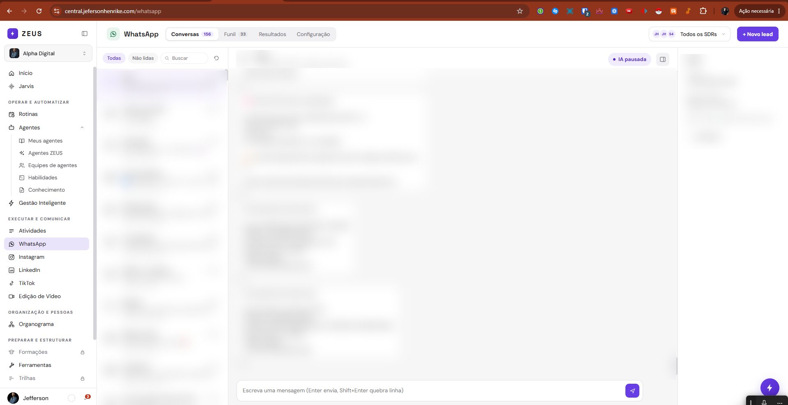
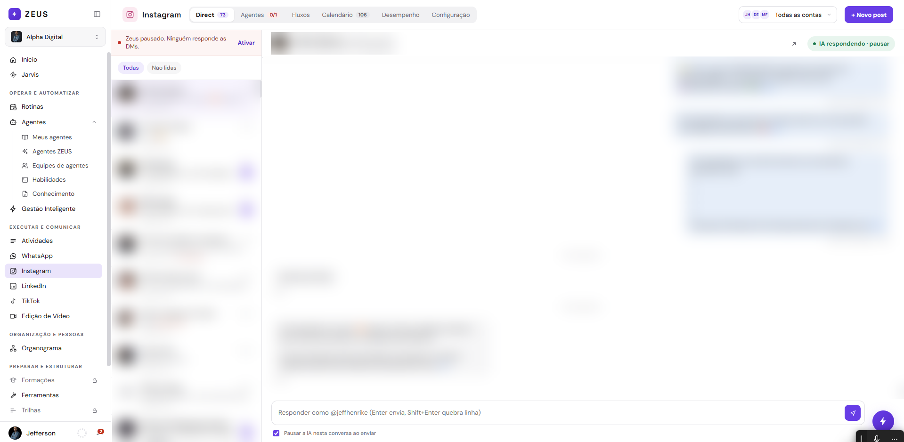

# Telas: WhatsApp, Instagram, Agente Posts, Agente de Design, LinkedIn e TikTok

Estado do código em 16/10/2026 (somente leitura). Origem geral: `/opt/jeff-apps/jeff-central/public/`. Os valores de cor e de estilo não são repetidos aqui: ver `../componentes-e-telas.md` (constantes) e `../../../01-identidade/tokens/zeus-central.css` (paleta).

## Convenções lidas no código (valem para as 6 seções)

- **Duas famílias de constantes.** O LinkedIn e o TikTok usam as constantes globais do `index.html`: `CFG_BOX`, `CFG_IN`, `LI_BTN`, `LI_BTN_PRI`, `LI_STATUS` e o aviso `cfgAviso`. WhatsApp, Instagram, Design e Brand Kit são módulos próprios (IIFE em arquivo separado) com constantes locais equivalentes e de mesmo desenho: `BOX`/`CARD` (cartão branco de borda fina), `IN`/`TA` (campo e área de texto), `LBL` (rótulo em caixa alta), `HELP` (texto de ajuda), `BTN_PRI`, `BTN_SEC`, `BTN_MINI`, `BTN_DANGER`, `BTN_TOP` (botão roxo de 36px do topo), `BTN_ROW` (botão de 32px de linha), `CHIP` (selo arredondado), `SEG(on)` (controle segmentado) e `HEAD` (Space Grotesk). Nomes de cor locais: `ROXO`, `ROXO_E` (roxo escuro), `TINT` (roxo claro de avatar e seleção), `SEL`, `VERDE`, `VERM`, `AMBAR`, `CINZA`, `MUTE`, `BOLHA`/`BOLHA_B` (bolhas do chat). São a mesma paleta do `zeus-central.css`.
- **Barra de topo com abas em pílula** (padrão de WhatsApp e Instagram): faixa branca com borda inferior, ícone quadrado de 32px + nome, grupo de abas num trilho cinza claro (`#F1F1F3`, raio 10, rola na horizontal sem barra), seletor de SDR/conta à direita e botão `BTN_TOP` roxo. Aba ativa: fundo branco, peso 600, sombra leve.
- **Tela de altura cheia:** WhatsApp e Instagram montam `height:100vh` (coluna: barra do topo + área da aba). O `index.html` troca para `calc(100dvh - 56px)` no celular e zera o recuo lateral dessas telas.
- **Celular (até 820px)**, regras globais em `index.html` linhas 69 a 105 (`@media (max-width:820px)`): menu lateral vira gaveta com barra `#mob-top` de 56px; margens de 40px viram 16px no primeiro nível; grades com `minmax` de 230px ou mais viram 1 coluna; tabelas rolam na horizontal; painéis laterais de largura fixa `flex:0 0 2xx` com `border-right` viram faixa horizontal rolável no topo; no Agente de Design a coluna de chat `flex:0 0 330px` desce para baixo da arte.
- **Quem vê:** WhatsApp e Instagram só renderizam para administrador (`souAdmin()`); senão mostram título + frase "Só administradores da conta acessam...". Detalhe por tela abaixo.
- **Tema escuro:** não há paleta própria. `html.tema-escuro` inverte via filtro e desfaz em imagens, vídeo e iframe (`[data-no-invert]` no QR code).

## Mapa de navegação (onde cada tela aparece)

| Tela | Rota | Entrada no menu |
|---|---|---|
| WhatsApp | `/whatsapp` | Menu lateral, seção EXECUTAR E COMUNICAR, item "WhatsApp" |
| Conector WhatsApp Business (Evolution + Zeus bot) | `/waConnector` | Conectores (`/conectores`), cartão "WhatsApp Business" (botão de volta "Conectores") |
| Instagram | `/instagram` | EXECUTAR E COMUNICAR, item "Instagram"; também abre direto em Configuração › Contas a partir de Conectores (`state.igAbrir`) |
| Agente Posts | `/agente/agente-posts` (painel em `/posts/index.html#/<tela>`) | OPERAR E AUTOMATIZAR › Agentes › Agentes ZEUS (categoria Marketing, "Agente Posts"). Não há item próprio no menu. O mesmo painel também aparece embutido em Instagram › Configuração |
| Agente de Design | `/agente/agente-design` e `/ferramentas/agente-design` | Agentes › Agentes ZEUS (Marketing); também PREPARAR E ESTRUTURAR › Ferramentas › Marketing (cartão "Agente de Design") |
| Brand Kit (Social Media) | aba "Brand Kit" do Agente de Design; `/ferramentas/social-media` redireciona para lá | Dentro do Agente de Design (a ferramenta antiga sai da lista de Ferramentas, `FERR_DENTRO_DE_AGENTE`) |
| LinkedIn | `/linkedin` | EXECUTAR E COMUNICAR, item "LinkedIn" |
| TikTok | `/tiktok` | EXECUTAR E COMUNICAR, item "TikTok" |

Registro em `RENDERERS` (`index.html` linha 7504): `whatsapp: renderWhatsapp` (placeholder "Carregando WhatsApp...", linha 2559, sobrescrito por `whatsapp.js`), `instagram` (placeholder "Carregando Instagram...", sobrescrito por `instagram.js`), `linkedin: renderLinkedin`, `tiktok: () => renderRedeEmBreve("tiktok")`, `waConnector: renderWaConnector`.

---

## WhatsApp

*Dados pessoais (nomes, telefones, mensagens) desfocados no print.*

**Rota e menu:** `/whatsapp`, EXECUTAR E COMUNICAR › WhatsApp.
**Objetivo:** operar SDRs de pré-atendimento no WhatsApp (chips ou ZEUS), com conversas, funil de leads, resultados e configuração.
**Origem:** `public/whatsapp.js` (939 linhas, `RENDERERS.whatsapp` na linha 924, `page()` 132, `topo()` 138, `main()` 168). Estado em `state.waSdr` (função `W()`, linha 30; `state.wa` é do conector, outro formato).

### Layout
- Raiz `#wa-root`: coluna `height:100vh` com `#wa-top` (barra) e `#wa-main` (área da aba, fundo `#F6F6F7`, `display:flex`).
- **Barra do topo (`topo()`):** ícone verde 32px + "WhatsApp"; abas em pílula **Conversas** (contador de não lidas), **Funil** (contador de leads), **Resultados**, **Configuração**; à direita o seletor "Todos os SDRs" (pilha de até 3 avatares de 24px + nome + chevron; menu `#wa-sdr-pop` de 290px com SDR, status em ponto colorido e "+ Novo SDR") e o botão `BTN_TOP` "+ Novo lead".
- **Acesso:** sem admin, o item mostra título e a frase de acesso restrito (linha 925).
- **Celular:** a barra quebra em linhas (`flex-wrap`). Coluna de menu da Configuração (220px, `border-right`) vira faixa horizontal pela regra global. A lista de conversas usa `flex:0 0 clamp(240px,30%,320px)` e não casa com a regra global: comportamento exato em tela estreita (a confirmar). O painel de detalhes do lead (270px) só abre sozinho com janela maior que 1280px (`detalhesOn()`), e tem botão para alternar.

### Abas e sub-abas

| Aba | `view` | Conteúdo |
|---|---|---|
| Conversas | `conversas` (`conversas()` linha 534) | 3 colunas: lista (30%, 240 a 320px) / conversa aberta / painel "Lead" (270px) |
| Funil | `leads` (`leads()` 675) | Kanban de leads por etapa |
| Resultados | `estatisticas` (`estatisticas()` 744) | Funil dos leads disparados, KPIs e gráficos |
| Configuração | `sdrs`, `maturacao`, `tags`, `chaves` (`config()` 179) | Menu lateral de 220px + painel com título, texto e botão de ação |

**Menu lateral da Configuração** (objeto `CFG`, linha 126): **SDRs** (contador de SDRs configurados; ação: interruptor "Mostrar os 16 slots" e `BTN_TOP` "+ Novo SDR"), **Maturar chips**, **Tags de IA** ("+ Nova tag"), **Chaves de IA** ("+ Adicionar chave"). Largura máxima do conteúdo: 900px (980px em Maturar chips).

**Conversas**
- Lista: pílulas "Todas" e "Não lidas" (`data-wa-cf`), busca por nome ou número, botão de sincronizar (`/sdrs/sync-chats`, acompanha por até 75 ciclos de 4s). Cada linha: avatar com iniciais, nome (negrito se não lida), prévia, hora, nome do SDR.
- Conversa: cabeçalho com avatar, nome, telefone formatado (`fmtFone`), botão do agente do SDR (liga ou pausa a IA, vale para todas as conversas dele) e botão de detalhes; mensagens em bolhas (`BOLHA`, `BOLHA_B`) com separador de dia; caixa de resposta com autocrescimento (Enter envia, Shift+Enter quebra linha).
- Painel "Lead": etapa do funil (seletor), telefone, SDR responsável, empresa/posição, origem (cadastro manual ou disparo), notas com salvamento automático, "Abrir ficha". Sem lead com aquele número: texto "Este contato ainda não está no funil." + botão "+ Criar lead".

**Funil (Kanban)**: 8 colunas fixas (`ETAPAS`, linha 655): Disparado, Conversa iniciada, Novo lead, Em negociação, Chamar novamente, Iniciou compra, Finalizou compra, Não vai / Perdido (cada uma com bolinha de cor própria). Coluna de 272px; coluna vazia encolhe para 44px com título vertical. Cabeçalho do funil: contagem de leads, barra de proporção por etapa, busca, dica "Arraste o cartão para mudar a etapa". Cartão do lead (`leadCard()` 696): avatar de iniciais em paleta, nome, telefone, selo do SDR, "respondeu ..." ou hora do disparo, nota em caixa amarela. Arrastar e soltar chama `/api/whatsapp/crm/stage`.

**Resultados**: faixa com 5 passos (Leads no funil, Receberam, Responderam, Em negociação, Fecharam) com percentual e barra; faixa de resumo (fila de disparo, conversas abertas, mediana de tempo até a resposta, respostas por IA hoje, perdidos); cartão "Disparos e respostas" (barras dos últimos 14 dias, fuso de Brasília); cartão "Por SDR" (tabela em grade: SDR, leads, respostas, IA hoje); cartão "Por etapa" (barras horizontais). Máximo 1120px.

**Configuração › SDRs** (`sdrs()` 194, `card()` 202): lista única dentro de um cartão com uma linha por SDR: avatar com ponto de status (`corStatus`), nome com lápis de edição, subtítulo "Ativo/Receptivo · estado · slot N · cargo", linha de disparo ("Disparando", "Pausado", "N enviados, N na fila, N erros"), botões `BTN_ROW`: iniciar/pausar/reiniciar disparo ou atendimento, "Instruções ✓", conectar chip / "Ver QR / código" / "Cancelar conexão" / "Desconectar chip", "Usar o ZEUS" / "Desativar ZEUS", "Configurações", e o interruptor `cfgSwitch` do agente.
**Maturar chips** (`maturacao()` 620): cartão "Aquecimento" (selo ligado/desligado, turnos mín/máx, espera mín/máx em segundos, máximo de sessões por chip por dia, "Salvar configuração"), cartão "Chips no aquecimento" (só conectados; precisa de 2 ligados) e "Histórico recente" (máx. 420px de rolagem).
**Tags de IA** (`tags()` 800): lista de tags (nome, categoria, cor, instrução); se o nome é igual a uma etapa do funil, o lead é movido.
**Chaves de IA** (`chaves()` 646): lista de chaves (provedor Anthropic, OpenAI ou Gemini; apelido; só 4 últimos dígitos; texto "A chave completa fica cifrada no servidor (AES-256-GCM)").

### Modais (`shell()` linha 267: fundo `rgba(23,23,26,0.32)`, cartão de raio 18, cabeçalho com título e X, corpo rolável, rodapé)
- `nome` (Novo SDR / Nome e cargo), `ativar` (escolha entre "ZEUS" e "chip"), `conectar` (abas segmentadas "QR code" e "Código", QR 256px ou código de 8 dígitos em monoespaçada, passos numerados, botão "Gerar novo QR code", rodapé com "Desconectar este chip"; atualiza a cada 3s e fecha sozinho quando conecta), `instrucoes` (textarea de 20000 caracteres), `config` (modal de 760px com alternância **Ativo/Receptivo** e sub-abas), `lead` (ficha: informações, chips de etapa, linha do tempo de marcos, anotações, Excluir só para leads manuais), `novoLead`, `tag`, `chave`.
- **Sub-abas do modal Configurações** (`ABAS`, linha 390): modo **Ativo**: Disparo (instruções do 1º contato, mensagens de disparo em rodízio, ritmo: espera mín/máx, pausa a cada N), Contatos (tiles Pendentes/Enviados/Erros, lista com selos Pendente/Enviando/Enviado/Erro/Repetido, adicionar por número, lista colada, planilha .xlsx ou link do Google Sheets, "Cancelar todos os pendentes"), Conversa, Avançado. Modo **Receptivo**: Gatilhos (chips de palavras ou frases, mensagem inicial), Conversa, Avançado.
  - Conversa: instruções, personalidade (0 a 10), link de referência, bloco "Inteligência artificial" (chave, provedor, modelo, limite diário, usadas hoje, pausar IA), recursos de envio (link, arquivo, imagem).
  - Avançado: modo de gatilho (contém / exata, só receptivo), "Compartilhar o chip de outro SDR" (`master_slot`), "Zona de perigo" (borda e título em `VERM`) com reset de memória.

### Componentes e selos
- `STATUS` do chip: Conectado (`VERDE`), Aguardando leitura (`ROXO`), Conectando... (`AMBAR`), Desligado (`CINZA`), Desconectado (`VERM`); no avatar vira ponto de 11px (`corStatus`).
- `vazio(t, sub)`: cartão de borda tracejada, título em negrito. `erroFaixa(msg)`: faixa de borda e texto em `VERM`.
- Mensagem de erro traduzida por `ERROS` (por exemplo sessão expirada: "Recarregue a página"; chip não conectado: "O chip desse SDR não está conectado.").

### Estados
- Carregando: "Carregando SDRs...", "Carregando leads...", "Calculando...", "Carregando mensagens...".
- Vazio: "Nenhum SDR configurado ainda" (com instrução de clicar em Novo SDR), "Sem conversas ainda...", "Nenhuma conversa sem ler.", "Nada com esse nome ou número.", "Nenhum contato..." na fila.
- Erro: "Não consegui falar com o sistema de SDRs" / "Não consegui falar com o CRM" (cartão `vazio` + mensagem).
- Desconectado: chip em `VERM`, subtítulo "desconectado", botão "Conectar chip".
- Sem permissão: texto de acesso restrito a administradores.
- Atualização: polling de 3s (`pollingOn()` linha 97) só com a tela ativa e aba visível; não repinta enquanto há foco em campo (exceto com conversa aberta). Modal de conexão atualiza o QR a cada ciclo.

### APIs (todas via `api()`; base `/api/whatsapp/p`, e CRM em `/api/whatsapp/crm`)
`GET /sdrs`, `POST /sdrs/sync-chats` e `GET /sdrs/sync-chats`; `PATCH /sdrs/:slot` (nome e cargo); `POST /sdrs/:slot/{toggle-active, zeus-mode, disconnect, reconnect, pair-code, dispatch/start, dispatch/pause, dispatch/reset-queue, reset-memory, ai-pause, ai-resume, media-upload, upload-contacts, upload-xlsx, upload-sheet}`; `GET/PUT /sdrs/:slot/{instructions, config}`; `GET /sdrs/:slot/{upload-jobs, ai-stats}` e `DELETE /sdrs/:slot/upload-jobs/:id`; `GET /conversations?slot&limit=300`, `GET /conversations/messages?slot&chat_id&limit=300`, `POST /conversations/{mark-read, reply}`; `GET/POST /maturation/{config, log}` e `/maturation/slot/:slot`; `GET/POST/DELETE /system/keys`; CRM: `GET /leads`, `POST /stage`, tags (`loadTags`), notas e criação de leads.

---

## WhatsApp: Conector WhatsApp Business e Zeus bot

**Rota e menu:** `/waConnector` (Conectores › cartão "WhatsApp Business", selo "Ativo" no catálogo, linha 564).
**Objetivo:** conectar números por QR (instâncias Evolution) e parear o número principal do ZEUS (Zeus Worker).
**Origem:** `index.html` `renderWaConnector()` (linha 3384; dados em `waLoad`, linha ~9353; carga ao entrar na tela, linha 8029) e `public/wa-zeus.js` (167 linhas, `window.waZeusHTML`, estado `state.waZeus`).

### Layout
- Contêiner `padding:26px 40px 60px; max-width:1180px`. Topo: botão de voltar "Conectores", logo (`connectorLogoHTML`, 46px), sobretítulo "NATIVO ZEUS · WHATSAPP" em roxo, `h1` "WhatsApp Business" (25px), frase de apoio, botões "Conectar novo número" (roxo) e "Atualizar".
- Seção **ZEUS BOT · NÚMERO PRINCIPAL** (de `wa-zeus.js`): cartão de até 560px com ícone preto de raio, nome "Zeus bot", número formatado, selo de estado, texto "Motor: Zeus Worker" + fila de envio, botões. Rótulo de seção "OUTROS NÚMEROS · EQUIPE" antes da grade.
- Grade de instâncias: `repeat(auto-fill,minmax(280px,1fr))`, gap 14. Cartão: avatar (foto ou 38px verde `#25D366` com iniciais), nome amigável, número, selo, "ID técnico", ações.
- **Celular:** a grade vira 1 coluna pela regra global (`minmax(280px` casa com `minmax(28`).

### Componentes e selos
- Selo da instância (função `statusInfo`): Conectado (verde), Aguardando QR (roxo), Desconectado (vermelho). Selo do Zeus bot (`ESTADOS` em `wa-zeus.js`): Conectado, Aguardando QR, Conectando..., Iniciando..., Desconectado, Falha de autenticação, Sem resposta.
- Botões do cartão: "Conectar/QR" (roxo, se não conectado) ou "Desconectar", "Renomear", "Excluir" (texto em vermelho, alinhado à direita).
- Modais: nome amigável ("Gerar QR"), QR de 260px com estado, "Atualizar QR", renomear. Zeus bot: modal de pareamento de 520px com abas "QR code" e "Código" (8 dígitos), botão "Reiniciar sessão" (confirmação) e passos numerados.

### Estados
- Carregando: "Carregando instâncias do Evolution..."; Vazio: "Nenhum WhatsApp conectado ainda" com botão; Erro: faixa vermelha (`st.error`); Zeus bot ausente (HTTP 404 na ponte): bloco oculto (`z.oculto`); sem sessão: caixa vermelha explicando que ele não responde até parear; aviso quando o número do Zeus bot também está cadastrado como instância Evolution.
- Só administrador do Zeus bot vê os botões (`s.admin`).
- Atualização: Zeus bot consulta o estado a cada 3s (5s a 6s sem modal) e o QR a cada 9s com modal aberto.

### APIs
Instâncias: `GET/POST /api/wa/instances`, `GET /api/wa/instances/:nome/qr`, `.../state`, `POST .../logout`, `DELETE .../:nome`, `PATCH .../:nome` (nome amigável). Zeus bot: `GET /api/wa/zeus`, `/qr`, `POST /pair`, `/restart`, `/logout`.

---

## Instagram

*Dados pessoais (nomes, telefones, mensagens) desfocados no print.*

**Rota e menu:** `/instagram`, EXECUTAR E COMUNICAR › Instagram.
**Objetivo:** responder DMs com agentes de IA (myIG), montar fluxos de conversa, agendar posts e acompanhar desempenho.
**Origem:** `public/instagram.js` (933 linhas; `RENDERERS.instagram` linha 914, `page()` 179, `topo()` 186, `main()` 213; estado `state.ig` em `G()` linha 39) e `public/ig-fluxos.js` (568 linhas, `window.igFluxos` linha 562, só a aba Fluxos). Acesso só de administrador (frase de acesso restrito, linha 915).

### Layout
- Mesma estrutura de WhatsApp: `#ig-root` coluna `height:100vh`, `#ig-top` (barra) e `#ig-main` (fundo branco na aba Direct, `#F6F6F7` nas demais).
- **Barra do topo:** ícone rosa de 32px (fundo `#FBEAF1`), abas em pílula **Direct** (não lidas), **Agentes** (ativos/total, com alerta), **Fluxos**, **Calendário**, **Desempenho**, **Configuração**; seletor de conta (pilha de avatares + "@usuario" ou "Todas as contas"; menu de 290px com seguidores, "· reconectar" e "+ Conectar conta"); botão `BTN_TOP` "+ Novo post".
- **Celular:** barra quebra em linhas; calendário tem `min-width:760px` dentro de contêiner `overflow:auto` (rola na horizontal); menu da Configuração (220px) vira faixa horizontal pela regra global; editor de Fluxos tem regra própria a 860px (corpo em coluna, canvas de 58vh, painel lateral embaixo com no máximo 52vh).

### Abas

| Aba | `view` | Função/linha | Conteúdo |
|---|---|---|---|
| Direct | `direct` | `direct()` 245 | Lista de DMs (30%, 240 a 320px) + conversa; sem painel de detalhes |
| Agentes | `agentes` | `agentes()` 319 | Cartões dos agentes de IA, máx. 860px |
| Fluxos | `fluxos` | `igFluxos.html()` | Lista de fluxos e construtor visual de blocos |
| Calendário | `calendario` | `calendario()` 532 | Agenda do mês (posts avulsos e itens de campanha) |
| Desempenho | `desempenho` | `desempenho()` 567 | KPIs, mapa de calor, próximas, falhas, publicações recentes |
| Configuração | `config` | `config()` 755 | Menu de 220px: Contas, Campanhas em massa, Geral |
| (sem aba) Novo post / Editar | `compose` | `compose()` 660 | Formulário de post com prévia ao lado |

**Direct:** pílulas "Todas" e "Não lidas"; faixa vermelha clara "sem agente ativo" quando nenhum agente está ligado. Cada linha: avatar (foto do perfil buscado por `perfisBuscar`), nome ou @, prévia (ou "IA pensando" ao vivo), hora relativa, "@conta · agente", selo de pausa. Conversa: cabeçalho com avatar, nome e @, seguidores, link "Abrir no Instagram", botão de pausa (`data-ig-pausa`: a IA para ou volta a responder naquela conversa); bolhas separadas por quem enviou: humano (operador ou a própria conta pelo app) em azul, IA e fluxo em roxo, rótulos "IA · ", "operador · ", "fluxo · ", "você pelo Instagram · "; mídia (áudio, imagem, vídeo; "imagem expirou na Meta"); caixa "Responder como @conta", opção "pausar a IA ao enviar" e última resposta da IA (status, modelo, duração). Se a conta escolhida no topo não é a ligada ao myIG: "As DMs automáticas só estão ligadas em @...".
**Agentes** (`cardAgente()` 335): quadrado colorido 44px com inicial, nome, modelo, "Ativo/Pausado" + interruptor `cfgSwitch`, prévia de 220 caracteres do prompt, links "Editar instruções", "Regras de entrada", "Apagar". Botão `BTN_ROW` "+ Novo agente". Modelos (`MODELOS`): Opus 4.7 (mais inteligente), Sonnet 4.6 (equilibrado), Haiku 4.5 (rápido e barato). Regras de entrada (`REGRAS`): Padrão, Palavra-chave, Primeira mensagem, DM vinda de comentário, Usuário específico (as três últimas marcadas como "ainda não usadas pelo motor"). Modal do agente (760px): nome, modelo, cor, instruções (monoespaçada), tempo máximo (30 a 600s), ativo, **Base de conhecimento** (segmentado "Sem base", "Toda a Biblioteca", "Pastas escolhidas", envio de arquivos até 50 MB para a pasta "Agentes do Instagram / nome", link "Abrir Biblioteca") e bloco de regras.
**Fluxos** (`ig-fluxos.js`): lista em grade `minmax(280px,1fr)`; cartão com selo "Ativo" (verde) ou "Rascunho" (cinza), nome, resumo do gatilho, execuções/concluídas/em andamento, duplicar e excluir. Estado vazio: "Nenhum fluxo ainda". Editor: barra superior (voltar "Fluxos", nome editável, estado "Salvo / Alterações não salvas / Salvando... / Não salvo" com autosave de 1s, "Simular", "Ativar fluxo" ou "Desativar", selo "Rascunho: não responde DMs"), faixa de problemas a corrigir, canvas pontilhado com zoom e enquadrar, botão redondo roxo de 52px "+" para adicionar bloco, painel lateral de 350px. Blocos (`TIPOS`): Quando... (gatilho por palavra-chave contém/exata ou primeira mensagem), Enviar mensagem (botões até 3 ou respostas rápidas até 13, título até 20 caracteres, botão pode abrir link), Enviar imagem (PNG/JPG/GIF/WebP até 8 MB), Enviar áudio (gravar ou enviar, convertido para M4A), Fazer pergunta (guarda resposta em variável `{{campo}}`), Esperar (até 23h), Agente de IA (passa a conversa). Variável `{{nome}}`. Simulador em painel lateral (nada é enviado).
**Calendário:** cabeçalho com setas de mês, "Hoje" e chips de filtro por grupo (Agendado, Publicado, Falhou, Rascunho; clicar esconde); grade de 7 colunas com células de 118px; hoje com círculo roxo; até 3 chips por dia e "+N no dia" (abre modal do dia); clicar no dia abre "Novo post" nesse dia; clicar num chip abre o modal do post. Selos de status (`ST_POST`): Agendado, Publicando, Publicado, Falhou, Rascunho.
**Desempenho:** segmentado 7/30/90 dias, "Atualizar agora" (`/analytics/collect`), "Métricas atualizadas a cada 30 min"; cartão "PUBLICAÇÕES" (Entregues, Agendadas, Falhas, Taxa + barras por dia); "ALCANCE E ENGAJAMENTO" (alcance, views, curtidas, comentários...); "Melhores horários" (mapa de calor 7x24 em 5 tons de roxo) e "Janelas de pico"; "Próximas publicações", "Falhas recentes", tabela "Publicações recentes" (`min-width:680px`, rolável).
**Configuração:** *Contas* (grade `minmax(260px,1fr)` de cartões: avatar com anel em degradê, @, seguidores, estado ativa/reconectar, selos "Direct"; cartão tracejado "Conectar conta"), *Campanhas em massa* e *Geral* (iframe do painel Agente Posts, ver seção seguinte; cabeçalho "‹ Voltar" quando é o painel de conexão com a Meta).

### Modais
Agente (acima), `evento` (post da agenda: lâminas do carrossel, selos, quando, contas, legenda, erro da Meta em caixa vermelha, resultado por conta; rodapé: Excluir, Editar, **Publicar agora** com confirmação reforçada se o post está agendado para o futuro, porque antecipa a publicação; post de campanha: novo horário, legenda própria, "Remover da programação", "Abrir campanha"), `dia` (lista do dia + "Novo post neste dia").
Observação: **não há painel lateral de post**; o detalhe do post é sempre modal. O que tem coluna lateral é o formulário `compose()` (coluna de prévia + "Quando" à direita, `position:sticky`).

### Novo post (`compose()`)
Voltar "‹ Voltar" para o Calendário, título "Novo post" ou "Editar post #id" + selo, segmentado "Post único / Em massa" (Em massa abre a aba Config › Campanhas). Coluna esquerda (cartão `flex:1.5 1 420px`): Formato (Feed ou Reels / Story), Mídia (soltar ou escolher até 100 MB, imagem ou vídeo), Legenda (limite 2.200 e 30 hashtags, contador), Título interno, "Publicar em" (seletores de conta). Coluna direita (`flex:1 1 300px`, sticky): prévia no formato do Instagram (4/5, ou 9/16 em Story e vídeo) e cartão "Quando" com segmentado Agora / Agendar / Rascunho, `datetime-local` (horário de Brasília) e botão principal de 40px. Post já publicado vira somente leitura com aviso. Validações por alerta (`zAlert`).

### Estados
Carregando (`carregando()`), vazio (`vazio()` com borda tracejada), erro "Não consegui falar com o myIG" e "Não consegui carregar o desempenho", sessão do publicador expirada (redireciona ao login), conta que precisa reconectar ("· reconectar"). Atualização: polling de 5s mais SSE (`/api/instagram/p/stream`, eventos `run` e `message`).

### APIs
myIG via `/api/instagram/p`: `GET/POST/PUT/DELETE /agents`, `/agents/:id/rules`, `/rules/:id`, `GET /threads`, `GET /threads/:id`, `POST /threads/:id/{send, pause, resume}`, `GET /stream` (SSE), `/flows` (ig-fluxos: lista, `PUT /:id`, `POST /:id/duplicar`, `DELETE`, uploads). Base de conhecimento: `/api/instagram/kb/:agente` (e `/pasta`), `GET /api/knowledge`, `POST /api/knowledge`. Publicador via ponte `/zeuspost/api`: `/accounts`, `/summary`, `/schedule`, `/posts` (GET, POST, PUT, `/:id/publish`), `/upload`, `/analytics`, `/analytics/collect`, `/bulk/campaigns/:id/items/:item`.

---

## Agente Posts (agendador)

**Rota e menu:** é um Agente ZEUS (`agents-seed.js` linha 158, categoria Marketing) com `panel` definido em `AGENT_PANELS` (linha 296). Aparece como `/agente/agente-posts` e embute `/posts/index.html` em iframe. O painel também roda direto em `/posts/index.html` e embutido em Instagram › Configuração.
**Objetivo:** agendar, publicar e acompanhar posts do Instagram (feed, Reels, Stories, carrossel e campanhas em massa).
**Origem:** `public/posts/index.html` (24 linhas), `core.js` (237; roteador por hash `ZP.views.<nome>`), `posts.css` (192), `view-dashboard.js` (113), `view-calendario.js` (173), `view-novo.js` (143), `view-massa.js` (918), `view-analytics.js` (87), `view-contas.js` (370), `view-config.js` (177). Título do documento "Agente Posts". Painel é uma página própria, com paleta em variáveis CSS (`--bg`, `--card`, `--line`, `--amber` (roxo da marca, nome herdado), `--green`, `--red`, `--blue`, `--head`...), não usa as constantes `CFG_*`.

### Layout
- **Barra de abas do agente** (`agPanelTabsInner`, `index.html` linha 6856): faixa branca de 10px/22px com borda inferior, rolável na horizontal; primeiro "Agente" (chat) e, depois de um divisor de 1px, 7 abas em ordem: **Dashboard, Calendário, Novo post, Em massa, Analytics, Contas, Configurações**, cada uma com ícone; ativa em fundo roxo claro. Trocar de aba muda só o hash do iframe, sem recarregar. O painel avisa por `postMessage({zpRoute})` quando navega por dentro (ex.: botão "Novo post") e a barra acompanha.
- Fora do agente (acesso direto ou iframe do Instagram) não existe barra de abas: a navegação é por links e botões de cada página (hash `#/dashboard`, `#/calendario`, `#/novo`, `#/massa`, `#/analytics`, `#/contas`, `#/config`).
- Página padrão `.page`: `max-width:1280px`, `padding:28px 32px 70px`; cabeçalho `.page-head` (título `h1` 23px Space Grotesk + subtítulo `.sub` + botões `.btn`), linha inferior de 1px.
- **Celular:** o painel tem breakpoint próprio em **900px** (não 820): colunas `.two`, `.cols-2`, `.cols-3` viram 1 coluna, `.page` fica com 20px/16px, células do calendário caem para 74px de altura e o texto dos chips some.
- Componentes próprios do painel (`posts.css`): `.btn` (+ `.pri`, `.ghost`, `.danger`, `.sm`), `.seg` (segmentado), `.inp/.sel/.txa`, `.card/.card-h/.card-b`, `.kpi`, `.badge` (+ `b-green`, `b-amber`, `b-red`, `b-blue`, `b-violet`), `.tag`, `.note` (`warn`, `err`, `ok`, `info`), `.list > .li`, `table.tb`, `.state` (vazio/carregando com `.spin`), `.ov/.modal` (modal 560px; `.wide` 860px), `#toasts/.toast` (`ok`, `err`), `.cal*`, `.ev.s-<status>`, `.gal/.gcard`, `.acc` (seletor de conta), `.drop`, `.preview`.

### Abas

**Dashboard** (`#/dashboard`, `view-dashboard.js`, título "Visão de publicações"): filtros de conta e período (7/30/90 dias), "Atualizar", "Novo post". Avisos `.note`: publicador parado (`err`) e conta que precisa de atenção (`warn`, link para Contas). Linha da conta (avatar, @, seguidores, selo "Publicador ativo/parado"). Bloco principal: número "Publicações entregues" com gráfico de área + métricas com sparkline (Agendadas, Falhas, Taxa de entrega, Campanhas ativas, Rascunhos, Alcance total). Seção "Tendências" (4 cartões: publicações por dia, falhas por dia, fila dos próximos 14 dias, engajamento acumulado). Seção "Diagnóstico": cartões "Próximas publicações" e "Falhas recentes" (lista `.li` com miniatura, hora, conta, tipo), "Publicações por conta" e "Distribuição por formato" (barras horizontais), "Últimas publicadas". Recarrega a cada 60s (`ZP.every`). Estados vazios: "Nada na fila" (com botão "Agendar post"), "Sem falhas", "Nada publicado ainda".

**Calendário** (`#/calendario`, `view-calendario.js`): ver detalhe abaixo.

**Novo post** (`#/novo` ou `#/novo?id=N&date=AAAA-MM-DD`, `view-novo.js`): grade `.two` (1,35fr / 1fr). Esquerda, cartões: Formato (Feed ou Reels / Story, com dica), Conteúdo (título interno, legenda com contador 2.200 e 30 hashtags, mídia com área `.drop` ou miniatura + "Trocar/Tirar"), "Onde publicar" (grade de `.acc` com avatar, @, caixa de seleção, contador "N contas selecionadas"; vazio: "Nenhuma conta conectada" + "Conectar perfil"), "Quando publicar" (Agora / Agendar / Rascunho, `datetime-local` em horário de Brasília). Direita (`position:sticky`): cartão "Prévia" (imitando o feed: avatar + @, arte 1/1, 9/16 em Story e Reels, legenda de até 150px com rolagem) e botões "Excluir" (só se editável) e salvar principal ("Publicar agora", "Agendar post/Salvar agendamento", "Salvar rascunho"). Publicar agora pede confirmação. Se a Meta recusa, o post fica salvo e reabre em edição.

**Em massa** (`#/massa`, `view-massa.js`): lista de campanhas com KPIs, aviso do scheduler (ok: "Scheduler ativo"; warn: "Worker dedicado parado"), filtro segmentado (Todas, Em andamento, Paradas, Concluídas), cartão por campanha (nome, selo de estado, formato, barra de progresso, próximos horários; ações Pausar, Retomar/Ativar, Excluir, recalcular horários, detalhes com tabela de itens `table.tb` rolável a 340px). Botão "Nova campanha" abre o assistente de 6 passos (`PASSOS`): Formato, Mídias (fonte: Google Drive ou upload direto, com progresso em XHR), Contas, Agenda ("Volume e horários": por dia, dias, horários), Legendas (fixa, IA ou outra regra, com status da chave de API), Revisão e prévia (grade gerada e avisos). Vazios: "Nenhuma campanha ainda", "Nenhum Instagram conectado".

**Analytics** (`#/analytics`, `view-analytics.js`): botão "Atualizar métricas"; bloco principal "Alcance" + área e 6 métricas; "Melhores horários" (mapa de calor + "Janelas de pico"); "Contas" (cartões com seguidores); "Publicações recentes" (segmentado Mais recentes / Maior alcance / Maior engajamento; tabela com miniatura, conta, data, alcance, views, curtidas, comentários, salvos e link externo; clicar na linha abre modal `wide` com o resultado por conta).

**Contas** (`#/contas`, `view-contas.js`): botões "Guia passo a passo" e "Atualizar contas"; seções "Conectar nova conta" (3 cartões `cols-3`: Instagram, YouTube e TikTok; o OAuth abre em outra aba, pois Facebook, Google e TikTok não rodam em painel embutido; YouTube e TikTok sem app configurado mandam para Configurações), "Contas conectadas" (cartão com total, "Verificar permissões", "Importar via BM (Meta)" e a lista), "Diagnóstico da conexão com a Meta" (botão "Rodar diagnóstico", limite de 12 consultas por minuto), "Importar contas com token do Explorador da Graph API" (campo de senha + botão), "Ajuda para configurar os apps". Vazio: "Nenhuma conta conectada ainda".

**Configurações** (`#/config`, `view-config.js`): cartões `cf-card` por grupo: Meta / Instagram (App ID, App Secret, ID de configuração do Login para Empresas), Google / YouTube, TikTok, "Inteligência artificial" (chaves usadas para gerar legendas), "Google Drive" (conectar e testar) e a seção "Senha do acesso direto (site antigo)" (troca de senha).

### Calendário em detalhe (`view-calendario.js`)
- **Cabeçalho:** `h1` "Calendário" + frase, segmentado de 3 modos **Mês / Galeria / Lista**, botão primário "Novo post". Linha de controles: seta anterior, "Mês Ano" (`h2`, 190px), seta próxima, "Hoje", e à direita três `.sel`: conta, status (Todos os status, Agendados, Publicados, Falhas, Travados na sequência, Rascunhos, Pausados) e formato (Feed, Reels, Carrossel, Stories). Linha de legenda com contagem por status (Agendado em roxo, Publicado em verde, Falhou em vermelho, Travado na sequência em violeta, Rascunho ou pausado em cinza) e dica "clique num dia para criar um post" (Mês) ou "clique numa arte para ver em tamanho grande" (Galeria).
- **Mês:** `.cal` com cabeçalho DOM a SÁB e grade de 7 colunas (`.cal-cell`, mínimo 112px); hoje com número em círculo roxo; fora do mês em fundo mais claro. Cada evento é um `.ev.s-<status>` (hora em negrito + texto, barra lateral de 3px na cor do status), máximo 3 por dia e "+N no dia" abre modal com a lista e "Novo post neste dia". Clicar na célula vai para `#/novo?date=...` (18:00 por padrão).
- **Galeria:** um cartão por dia, grade `.gal` (`minmax(168px,1fr)`), `.gcard` com arte em 4/5, ponto de status no canto, contagem de lâminas, hora, tipo, título, conta e selo.
- **Lista:** um cartão por dia com `.li` (miniatura, hora, título, conta, tipo, selo).
- **Painel do post (modal, `ZP.openEvento`, linha 7):** não é painel lateral; é o modal padrão (560px) com título "Post #id" ou título/ "Item de campanha". Conteúdo: arte (vídeo com controles, imagem clicável, ou grade de lâminas numeradas do carrossel), selos de status, tipo e campanha, "Quando" (data por extenso + tempo relativo) e "Contas", legenda em caixa cinza (máx. 180px), nome do arquivo, erro da Meta em `.note.err`, "Resultado por conta" (lista). Ações no rodapé: post avulso editável (rascunho, agendado, falhou, travado): **Excluir** (vermelho, confirmação), **Publicar agora** (ou "Tentar publicar agora" se falhou; confirmação; se a sequência do carrossel está travada oferece "Publicar fora de ordem"), **Editar** (primário, abre `#/novo?id=`). Item de campanha: **Abrir campanha**. Os resultados por conta e o `media_path` de carrossel chegam depois por `GET /posts`.
- Recarrega a cada 45s.

### Estados
Carregando (`ui.loading`, spinner roxo), vazio (`ui.empty`: ícone, título, texto, ação), erro de carga ("Não consegui carregar esta tela: ..." + "Tentar de novo"), sessão expirada (redireciona o topo para `/login`), tela inexistente ("Tela não encontrada"). Sem tratamento de permissão próprio: o acesso é o da sessão da Central.

### APIs (ponte `/zeuspost/api`, `core.js` linha 5)
`GET /accounts`, `/summary`, `/schedule`, `/analytics`, `/analytics/post/:id`, `/worker/status`, `/settings`, `/settings/ai`, `/drive/status`, `/diagnostics/meta`, `/accounts/permissions`; `GET/POST/PUT/DELETE /posts`, `POST /posts/:id/publish[?forcar=1]`, `POST /upload`; `POST /analytics/collect`; `/bulk/campaigns` (listar, criar, `PUT`, `/:id/{pause, activate, rebuild-slots}`, `DELETE /:id/items/:item`), `POST /bulk/preview`, `POST /drive/test`; `POST /settings`, `/settings/ai`, `/auth/change-password`; `DELETE /accounts/:id`, `POST /accounts/import-bm`; OAuth em `/zeuspost/oauth/<plataforma>/start`.

---

## Agente de Design (Estúdio, Criações, Estilos e Brand Kit)

**Rota e menu:** `/agente/agente-design` (aba do agente) e `/ferramentas/agente-design` (página de ferramenta, `index.html` linha 4268 chama `designPage()`); atalho `?c=<id>` abre o editor de uma criação. Item de catálogo em `FERRAMENTAS` linha 3688 (Marketing, plano LIBERADA).
**Objetivo:** criar posts de imagem com IA na identidade da marca (formato, objetivo, prompt, arte, ajustes por chat), guardar estilos e manter o Brand Kit.
**Origem:** `public/design.js` (751 linhas: `topo()` 62, `passoFormato()` 94, `passoModo()` 120, `passoCriar()` 175, `editor()` 283, `estilosHTML()` 462, `criacoes()` 513, `page()` 523, `designPage` 720, `agNativePanel` 745) e `public/social.js` (505 linhas: `lista()` 79, `wizard()` 234, `kit()` 274, `socialPage` 493). Feedback 👍/👎 no chat: `index.html` linhas 234 a 255.

### Layout
- **Dentro do agente** (`AGENT_PANELS['agente-design']`, `agents-seed.js` linha 306): barra de abas do agente (mesma barra do Agente Posts) com **Agente** (chat, aba inicial por `defaultTab:'chat'`), **Criar post**, **Criações**, **Estilos**, **Brand Kit**. As abas são nativas (sem iframe): `agNativePanel` devolve `designPage({embed:true, aba})` ou `socialPage({embed:true})`.
- **Página da ferramenta** (não embutida): faixa superior com "‹ Ferramentas", ícone e nome, trilho de abas Criar post / Criações / Estilos / Brand Kit.
- **Seletores comuns** (`topo()`): "Marca" (lista de marcas), "Motor" (**Automático**, **Nano Banana** (Google), **GPT Image** (OpenAI); sufixo "(sem chave)" quando a chave não está configurada) e "Qualidade" (**Rápida** ~30s, GPT Image 2.5 Flare; **Máxima** ~1 min, GPT Image 2.5 Sunburst, mais detalhe e texto pequeno legível). Em modo embutido só esses seletores aparecem, alinhados à direita.
- **Cores específicas desta tela:** azul `AZUL` nos botões primários de passo (`BTN`, raio 22, pílula) e no stepper, `ROXO` em destaques; cartões `CARD` com raio 16.
- **Celular (regras globais):** formatos em 2 colunas (`minmax(168px`); no editor o chat de 330px desce para baixo da arte e `#dz-chat` fica com 260px no máximo.

### Abas

**Criar post** (fluxo em 3 passos + editor; stepper "Formato, Modo, Criar" centralizado, estado em `state.dz`)
1. **Formato** (`passoFormato()`): título "Escolha o Formato da Imagem"; chips de plataforma (Todas, Instagram, Facebook, LinkedIn, WhatsApp e, desativados com cursor padrão, **TikTok, YouTube, Twitter/X** como "em breve", `EM_BREVE`); grade `minmax(168px,1fr)` de cartões de 150px em degradê por plataforma (`GRAD`), com miniatura proporcional, nome, dimensões "W × H px", selo "TOP" e ícone de carrossel; selecionado ganha anel branco + azul e check. Botão "Continuar".
2. **Modo** (`passoModo()`): objetivo (Engajar / Vender), Abordagem opcional (cartões com emoji, "ver mais"; descrição e regras da abordagem + regras do formato), número de slides (só carrossel), "Como você quer criar?" (**Criar do Zero**, **A partir de Link** (lê o link, mostra título e prévia do conteúdo), **Inspiração**: modal laranja com abas Todas, Datas, Oportunidades, Trends, cada ideia com "Usar sugestão"), campo da ideia, "Gerar prompt".
3. **Criar** (`passoCriar()`): três cartões-resumo (Formato, Modo, Objetivo), "Ideia original", "Prompt adaptado para <marca>" em textarea editável (cada "## Slide N" vira uma arte), "Refinar com IA", anexos (até 4 imagens), interruptores "Enviar logo" e "Usar referências da marca", seção "Legenda do post", botão "Criar arte".
4. **Editor** (`editor()`): tela dividida em arte (largura de até 560px, com skeleton animado enquanto gera) e painel de chat de 330px (`position:sticky`). Barra superior: "← Novo post", marca, formato e dimensões, selo de custo da versão ("Esta versão: US$ X (R$ Y)", "~" se estimado, "Sem custo novo (HTML)" quando a arte é montada em HTML), seletor de versão, **Refazer** (ou "Refazer slide"), **Baixar** (slide) e **zip** (todas as artes da versão + legenda). Arrastar sobre a arte seleciona uma **área** e o pedido vale só nela. Carrossel: miniaturas dos slides e seletor "Ajustar: todos os slides". Cartão "Legenda" com "Copiar". Chat do editor: mensagens "eu" e "ia" (texto do tipo "Pronto! Criei sua arte ..." / "Versão N pronta (motor)"), avisos de motor reserva e erros; campo "Ex: troque o fundo por azul, aumente o título".

**Criações** (`criacoes()` 513): cartão "Gasto com IA de imagem" no topo (Total, Este mês, Hoje; detalhe por modelo, origem, mês e as últimas 60 imagens em US$ e R$; nomes `nomeMod`: Nano Banana Pro, GPT Image 2.5 Flare, GPT Image 2.5 Sunburst; origens: Agente de Design, Zeus: ilustração (híbrido), Zeus: edição de foto) e grade `minmax(200px,1fr)` de criações (miniatura na proporção do formato, título, marca, selo de custo `custoCard`, lixeira). Vazio: "Nenhuma criação...".

**Estilos** (`estilosHTML()` 462; backend `/api/design/estilos`): até 7 estilos por marca. Grade `minmax(250px,1fr)` com capa 3/1.4, nome, "N referência(s) · N aprovada(s) · usado Nx", botões "Usar" (roxo; preenche o chat com "Quero uma arte no estilo ...") e "Abrir". "Novo estilo": nome + "Escolher referências" (galeria modal de prints enviados no chat e artes já criadas, máx. 25, busca e filtro "só <marca>") + upload de prints + links de posts do Instagram. Página de um estilo: referências (print ou link com perfil e lâminas, remover), "Adicionar referências", **Receita** (o que o ZEUS entendeu do estilo, editável), "Artes aprovadas nesse estilo", "Correções que você fez", Renomear, Excluir, "Usar este estilo". Limite: "Limite de 7 estilos: exclua um para criar outro." Vazio: "Nenhum estilo salvo ainda."

**Brand Kit** (`social.js`): **Lista** "Marcas" (sobretítulo "SOCIAL MEDIA · BRAND KIT", botão "Nova marca"): grade `minmax(290px,1fr)`; cartão com logo ou inicial 48px, nome, tag ou @, selo "COMPLETO" (verde) ou incompleto (âmbar), descrição de 2 linhas, bolinhas de cor, chip do objetivo, botões "Ver Brand Kit" (ou "Continuar") e lixeira. Vazio: "Nenhuma marca cadastrada ainda" + "Configurar marca" (5 passos, ~5 minutos). **Assistente de 5 passos** (barra de progresso em `AZUL`, bolinhas clicáveis, "Passo N de 5", Voltar/Avançar): 1 Objetivo (Vender, Construir autoridade, Aumentar engajamento, Gerar leads; cartões com ícone colorido), 2 Marca (nome, país com 10 opções, o que faz; "avançado": tag, @, site, diferencial, produtos), 3 Público (cliente ideal; avançado: dores, desejos, objeções), 4 Identidade (tom de voz com 10 chips, até vários; avançado: persona, formalidade 0 a 100 com rótulo Informal/Equilibrado/Formal, palavras que usa e que evita), 5 Estilo (logo PNG/JPG/WebP/SVG até 5 MB com cores detectadas; cores por 8 paletas prontas (`PALETAS`) ou personalizadas; "Descrição do estilo visual" gerada por IA com "Refinar com IA"; até 8 referências visuais, com modal de fidelidade: Cópia fiel, Inspiração forte, Referência livre). **Kit pronto** (`kit()`): cabeçalho com logo, selo e botão **Criar post** (volta para a aba Criar com a marca escolhida, `designAbrirMarca`), 5 blocos (um por passo, cada um com "Editar") e rodapé informativo.

**Feedback 👍/👎/💬 nas artes** (`index.html` 234 a 255, `mdToHtml` linha 6733): toda arte de `/api/design/arquivo/...` exibida numa resposta do chat ganha, abaixo da imagem, três botões de 12px (👍 "Gostei desta arte", 👎 "Não gostei: conte o que mudar", 💬 "Comentar esta arte") e a nota. 👍 fica verde e 👎 vermelho (fundos claros). Clicar de novo no mesmo valor desfaz. 👎 e 💬 pedem um `prompt()` do navegador com a nota; "não salvou, tente de novo" no erro. O valor vem de `GET /api/design/feedback?arquivo=` e é gravado por `POST /api/design/feedback`; o ZEUS lê isso antes da próxima arte. Arte que não carrega vira cartão tracejado "<alt> indisponível · abrir no editor" (`__arteFalhou`).

### Estados
- Carregando: "Carregando o Agente de Design...", "Carregando criações...", "Carregando estilos...", "Carregando marcas...".
- Vazios: sem marcas ("Cada marca...", botão de configurar); sem criações; sem estilos; sem motor ("Nenhum motor de ..." em faixa âmbar quando faltam as duas chaves); Brand Kit incompleto (faixa âmbar "O Brand Kit de <marca> est..." ); sem marca selecionada em Estilos ("Escolha uma marca no topo.").
- Erro: faixas `msgHTML` verde (aviso) ou vermelha (erro) de até 980px; "Não consegui carregar: ..."; criação que falhou aparece como mensagem "erro" no chat do editor.
- Geração em andamento: skeleton no lugar da arte, controles desabilitados (opacidade), mensagem "Gerando..." e polling em `vigiar()`.

### APIs
`/api/design`: `GET /catalogo`, `POST /inspiracoes`, `POST /link`, `POST /prompt`, `GET/POST /criacoes`, `GET/DELETE /criacoes/:id`, `POST /criacoes/:id/ajustar` (corpo: pedido, refazer, provider, qualidade, slide, área), `GET /zip/:id?v=`, `GET /gastos`, `GET /arquivo/...`, `GET /estilos?marca=`, `GET /estilos/imagens?tipo=chat|artes`, estilos (criar, renomear, receita, referências, excluir), `GET/POST /feedback`. `/api/social`: `GET` (lista de marcas), `POST` (criar), `PUT /:id`, `DELETE /:id`, `PUT/DELETE /:id/logo`, `POST /:id/refs`, `DELETE /:id/refs/:n`, `POST /:id/ia/estilo`.

---

## LinkedIn

**Rota e menu:** `/linkedin`, EXECUTAR E COMUNICAR › LinkedIn.
**Objetivo:** escrever, gerar com IA, agendar e publicar posts no perfil conectado do LinkedIn, com estratégia semanal.
**Origem:** `index.html`: `LI_STATUS` linha 10327, `liCarregar` 10348, `liConexaoHTML` 10469, `liEngajamentoHTML` 10508, `liListaHTML` 10536, `liEditorHTML` 10554, `renderLinkedin` 10615. `public/linkedin-estrategia.js` (212 linhas; `liEstrategiaHTML`, `liIrAba`). Estado: `state.li` (conexão), `state.liPosts`, `state.liFiltro`, `state.liEd` (post aberto), `state.liIA`, `state.liArtes`, `state.liEng`, `state.liEst`, `state.liAba`. O editor guarda o texto sem repintar; `liRender()` marca a tela como "suja" antes de `render()`.

### Layout
- Contêiner `padding:26px 40px 60px; max-width:1240px`. Cabeçalho padrão de tela: "Conta <empresa>" (12px), `h1` 28px com ícone roxo de 24px, parágrafo de até 720px.
- **Barra de conexão** (`liConexaoHTML`) logo abaixo; depois **abas "Posts" e "Estratégia"** (trilho `#F1F1F3`, raio 10); depois o conteúdo da aba.
- **Aba Posts:** `.li-grade` com `grid-template-columns:minmax(260px,340px) minmax(0,1fr)`, gap 18. Esquerda: lista de posts; direita: editor, e abaixo (se publicado) o cartão de Engajamento, e a Prévia.
- **Celular:** a 900px (`@media (max-width:900px)` embutida na tela) `.li-grade` vira 1 coluna.

### Barra de conexão (`liConexaoHTML`, `CFG_BOX`)
| Estado | Aparência |
|---|---|
| Erro de status | `cfgAviso` "Não foi possível carregar: ..." |
| Não configurado | `CFG_BOX`: "Faltam as chaves linkedin_client_id e linkedin_client_secret nas chaves da Central." |
| Não conectado ou expirado | `CFG_BOX` com texto ("A conexão expirou. O LinkedIn libera o acesso por 60 dias..." ou "LinkedIn não conectado. Dá pra escrever e salvar rascunhos; para publicar, conecte o perfil.") + botão `LI_BTN_PRI` "Conectar conta" ou "Reconectar" (link para `/api/social/linkedin/conectar`) |
| Conectado | `CFG_BOX` compacto: ponto de 9px (verde; âmbar com 7 dias ou menos), "Conectado como **Nome** · vale até dd/mm/aaaa" ou "expira em N dias" em negrito âmbar, link "Reconectar" (se ≤7 dias) e "Desconectar" em vermelho (confirmação) |

### Lista de posts (`liListaHTML`, `CFG_BOX` com padding menor)
Cabeçalho "Posts" + `LI_BTN_PRI` compacto "+ Novo"; filtros em pílula: Todos, Rascunhos, Agendados, Publicados, Com erro (só aparecem os que têm itens, ou o ativo), cada um com contagem; ativo em fundo escuro `#17171A` e texto branco. Itens: miniatura 44px (JPG 240 px via `liMini`), selo de status (`LI_STATUS`: Rascunho cinza, Agendado âmbar, Publicando azul, Publicado verde, Com erro vermelho), data (publicado, agendado ou sugerida), texto em 2 linhas, selos de pilar (roxo claro) e "Newsletter" (azul claro, `liSelosPost`). Item aberto: borda roxa e fundo roxo muito claro. Lista com altura máxima de 620px e rolagem. Vazio: "Nenhum post ainda." / "Nenhum post aqui."

### Editor (`liEditorHTML`, `CFG_BOX`)
- Título "Novo post" / "Editar post" / "Edição da newsletter" + selo de status + selos; à direita o botão **"Gerar com IA"** (borda e texto roxos) quando editável. Post publicado fica somente leitura (textarea `readonly`).
- **Gerar com IA** (`liAbrirIA`, caixa roxa clara com borda): campo "Sobre o que é o post?", seletores de tom (Autoridade, História pessoal, Prático / lista, Provocativo, Bastidor), pilar da estratégia ("Pilar: livre" + os pilares salvos) e tamanho (Curto, Médio, Longo), botões "Reescrever o texto atual" e `LI_BTN_PRI` "Gerar post" (vira "Gerando..."). Vindo do chat, mostra antes "Este rascunho veio de uma resposta do chat. Quer que a IA reescreva no formato de post do LinkedIn?".
- Textarea (`CFG_IN`, 11 linhas) com dica das 2 primeiras linhas antes do "ver mais"; contador `n / 3.000` (`n / 20.000` em newsletter) que fica vermelho acima do limite.
- **Imagens:** miniaturas de 76px com X, botão `LI_BTN` "Enviar imagem" (PNG/JPG/GIF/WebP até 8 MB, até 9 imagens) e **"Artes do Agente de Design"** (abre caixa com as artes agrupadas por marca, formato e data; clicar numa imagem a adiciona ao post: `GET /artes`).
- **Ações (rodapé do editor):** rascunho/agendado: seletor `datetime-local` ("Agendar para" ou "Data sugerida pelo plano"), Excluir (vermelho), "Salvar rascunho" (vira "Cancelar agendamento" se estava agendado), "Agendar" (ícone de histórico) e `LI_BTN_PRI` **"Publicar agora"** (desabilitado e opaco se não conectado; confirmação "Publicar este post agora no seu LinkedIn? Ele fica público na hora."). Newsletter: aviso de que a API não publica edição de newsletter, "Salvar", "Copiar texto" e `LI_BTN_PRI` "Abrir editor de artigo". Publicado: `LI_BTN_PRI` "Abrir no LinkedIn" e "Tirar da lista".
- Erro anterior: `cfgAviso` "Última tentativa falhou: ...".
- **Prévia** (`CFG_BOX`, rótulo "PRÉVIA"): avatar e nome, texto cortado em 210 caracteres com "… ver mais" (`liPreviaTexto`), grade de até 4 imagens (1 coluna se uma só, senão 2).
- **Engajamento** (só publicado, `liEngajamentoHTML`): tiles de Reações, Comentários, Impressões, Alcance e Compartilhamentos; barras "REAÇÕES POR TIPO" e "POR DIA"; botão "Atualizar" e "Atualizado há N min"; link "Ver comentários no LinkedIn". Sem a permissão Community Management, o LinkedIn só libera reações e a tela mostra um aviso explicativo.

### Aba Estratégia (`linkedin-estrategia.js`; só administrador edita, os demais veem os campos desabilitados)
- **Primeiro acesso (sem estratégia, administrador):** abre direto a **conversa guiada** "Montar a estratégia com o ZEUS" (cartão de até 760px, ~6 perguntas, bolhas roxas do usuário e cinzas com ícone de raio do ZEUS, chips de sugestão de resposta, contador "N de ~6", link "Pular e preencher do zero"). O resultado vira o formulário com o resumo "O que o ZEUS entendeu" e nada é salvo antes de "Salvar estratégia".
- **Boas-vindas** (alternativa): textarea de briefing, `LI_BTN_PRI` "Sugerir com IA" e `LI_BTN` "Preencher do zero"; não editor: "Peça a um administrador da conta para definir."
- **Formulário** (cartão `CFG_BOX` de até 980px, seções separadas por borda): Objetivo (Autoridade, Gerar leads, Os dois), Público e posicionamento, **Pilares de conteúdo** (até 8; nome, peso 0 a 100 com percentual e barra, descrição; "Adicionar pilar", "Equilibrar pesos"), Tom de voz (até 3 chips entre Direto, Didático, Provocativo, Inspirador, Técnico, Bem-humorado + "Como escrever"), Ritmo e formatos (posts por semana 1 a 7, horário, dias Seg a Dom, formatos Só texto / Texto + imagem / Várias imagens), Newsletter (ativa, nome, frequência Semanal/Quinzenal/Mensal, dia), Chamada e limites (CTA padrão e "O ZEUS nunca deve"), Automático (planejar sozinho) e, se há estratégia salva, "Como fica a próxima semana" (prévia das vagas por pilar e formato).
- **Barra fixa inferior:** `LI_BTN_PRI` "Salvar estratégia" (desabilitada sem mudanças, mostra "Salva"), "Descartar alterações", "Refazer com a IA", e à direita "Planejar esta semana" e `LI_BTN_PRI` "Planejar a próxima semana" (confirmação; nasce como rascunho com data sugerida, nada é publicado sem aprovação). Tarefas de IA (sugerir, planejar, conversa) mostram faixa roxa clara com spinner e "pode levar até 2 minutos", acompanhadas por polling de 2,5s. Depois de planejar, volta à aba Posts com filtro "Rascunhos".
- Chip de seleção (`chip()`): pílula com borda e fundo roxo claro quando ativa.

### Entrada do chat
Botão "LinkedIn" na barra de ações de cada resposta do chat (`data-chat-li`, `chatParaLinkedin`, linha 10454) cria um rascunho (`POST /posts/do-chat`) e abre a tela com a caixa de IA sugerindo adaptar o texto.

### Estados
Carregando ("Carregando LinkedIn..."), erro de status (aviso), não configurado, desconectado/expirado, lista vazia, publicando (botão "Publicando..."), gerando ("Gerando..."), toast `cfgToast` para sucesso e erro ("Rascunho salvo.", "Agendado para ...", "Publicado no LinkedIn.", "Esse horário já passou."). Retorno do OAuth: `?ok` mostra "LinkedIn conectado." e `?erro=` mostra "Não conectou: ...". Permissão: leitura e escrita pela sessão; edição da estratégia só admin; (acesso de membro sem admin à tela em si: a confirmar).

### APIs (base `/api/social/linkedin`)
`GET /status`, `GET /posts`, `POST /posts`, `PUT /posts/:id`, `DELETE /posts/:id`, `POST /posts/:id/publicar`, `GET /posts/:id/engajamento[?forcar=1]`, `POST /posts/do-chat`, `POST /gerar`, `GET /artes`, `POST /desconectar`, `GET /conectar` (redireciona ao OAuth). Estratégia (`/estrategia`): `GET`, `PUT`, `POST /sugerir`, `POST /planejar`, `POST /conversa`, `GET /tarefa/:id`.

---

## TikTok

**Rota e menu:** `/tiktok`, EXECUTAR E COMUNICAR › TikTok.
**Objetivo:** informar que a integração ainda não está ligada e listar os passos para ligar.
**Origem:** `index.html`: `RENDERERS.tiktok = () => renderRedeEmBreve("tiktok")` (linha 7508), `REDES_EM_BREVE` (linha 10305), `renderRedeEmBreve(id)` (linha 10311).

### Layout
Contêiner `padding:26px 40px 60px; max-width:860px`. Linha "Conta <empresa>", `h1` 28px com ícone do TikTok (24px, roxo), parágrafo de até 640px: "Publicar vídeos verticais direto no TikTok (ou como rascunho no app enquanto a auditoria não sai), com legenda, aprovação e agendamento." Abaixo, um `CFG_BOX` (22px/24px) com o selo âmbar "Integração em configuração" e uma lista numerada (`ol`, 13,5px, entrelinha 1,9).
Passos (`REDES_EM_BREVE.tiktok.passos`): 1 Criar o app no TikTok for Developers; 2 Ativar Login Kit e Content Posting API; 3 Salvar Client Key e Client Secret nas chaves da Central; 4 Conectar a conta e enviar o primeiro vídeo de teste; 5 Pedir a auditoria do TikTok para liberar a publicação pública direta.
**Celular:** o padding de 40px vira 16px pela regra global.

### Estados e interações
Tela estática: sem carregamento, sem botões, sem chamada de API, sem tratamento de permissão. É o padrão para integração ainda não ligada. Observação: `REDES_EM_BREVE` também tem a entrada `linkedin`, hoje sem uso (o LinkedIn tem tela real). Em outras telas o TikTok aparece como "em breve" (Agente de Design: chip desabilitado; Agente Posts › Contas: cartão de conexão do TikTok com OAuth próprio do painel de publicação).

---

## Pontos a confirmar

- Comportamento de WhatsApp › Conversas e Instagram › Direct em tela abaixo de 820px: a lista de conversas usa `flex:0 0 clamp(...)` e não casa com a regra global de painéis laterais; como fica a coluna de conversa em celular não foi verificado em execução.
- Aba "Agente" (chat) do Agente Posts e do Agente de Design: layout do chat do agente em si não foi lido (pertence ao capítulo de Agentes).
- Entrada de menu dedicada para o Agente Posts: só encontrei o caminho Agentes › Agentes ZEUS e o iframe em Instagram › Configuração; se há atalho adicional na Home (a confirmar).
- LinkedIn: o que um membro sem permissão de administrador enxerga na tela (a restrição existe só na edição da estratégia e no servidor).
- Linhas exatas de `waLoad`/`waRender` no conector WhatsApp (cita-se aproximação ~9353).
- Seções "Contas conectadas" do Agente Posts e "Campanhas em massa": o detalhe de cada cartão de conta e de campanha foi resumido, não lido linha a linha.
- Fluxos do Instagram: rotas exatas do backend do construtor (`/api/instagram/p/flows/...`) além de lista, duplicar, excluir e salvar.
