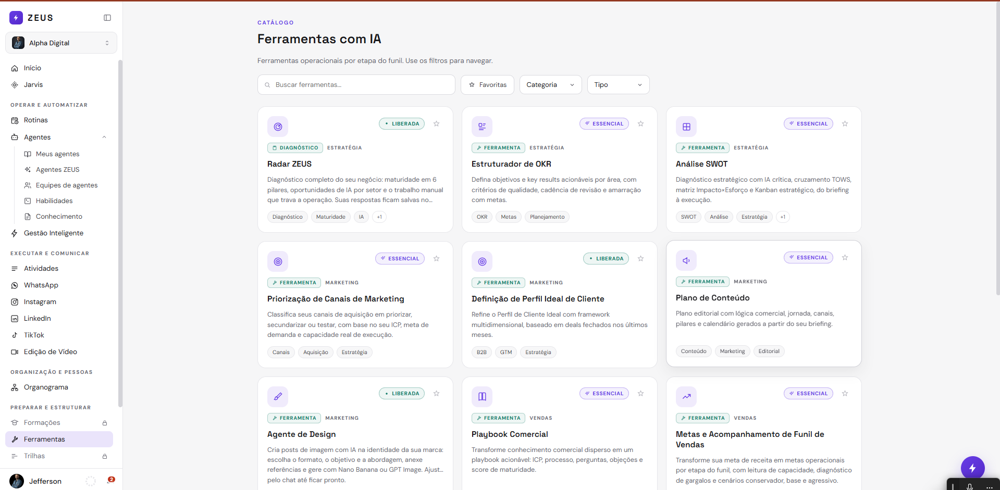
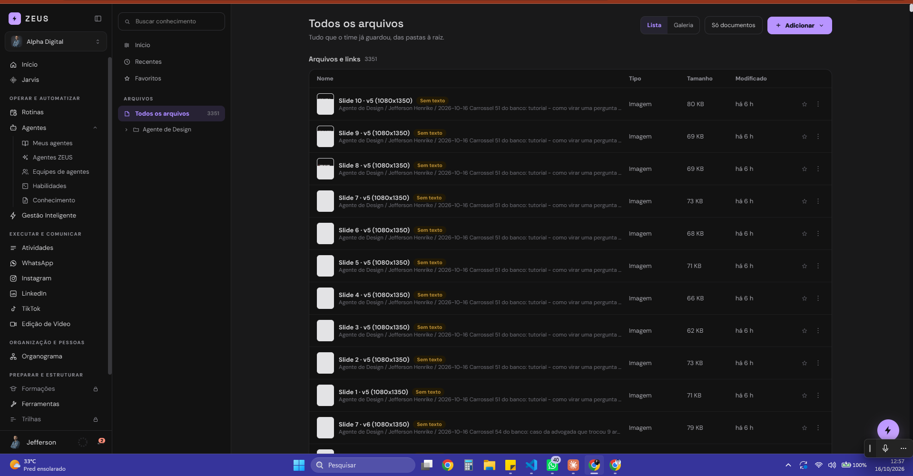
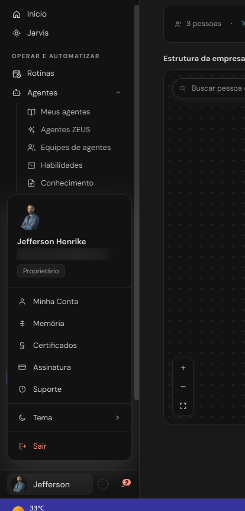
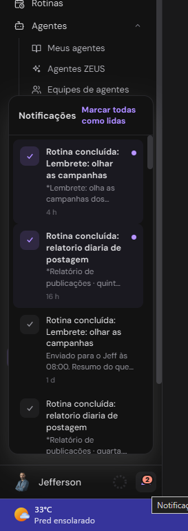

# Telas: Organograma, Ferramentas, Biblioteca, Conectores, Configurações e estrutura geral

Estado do código em 16/10/2026. Fonte: `/opt/jeff-apps/jeff-central/public/` (`index.html`, `organograma.js`, `biblioteca.js`, `conectores-destaque.js`, `wa-zeus.js`, `vendas.js`, `login.html`, `convite.html`). Números de linha são aproximados.

Convenções usadas neste documento:
- Constantes de estilo citadas pelo nome (`CFG_BOX`, `CFG_H2`, `CFG_LBL`, `CFG_IN`, `PDI_IN`, `LI_BTN`, `LI_BTN_PRI`, `TM_*`, `HC_*`) e a paleta (roxo de marca, cinza de texto secundário, verde "ok", âmbar "atenção", vermelho "erro") estão em `componentes-e-telas.md` e em `01-identidade/tokens/zeus-central.css`. Aqui não se repetem os valores.
- A Central não usa classes CSS por componente: o HTML é montado com estilo inline. A exceção são os atributos de hover (`data-hover`, `data-hover-border`, `data-hover-dark`) e as classes `pop-down`/`pop-up` (animação de entrada), `cat-select` (select padrão), `cat-card`, `rail-icon`.
- Regra global de celular (`@media (max-width:820px)`, `index.html` ~71 a 105): a sidebar vira gaveta, o conteúdo ocupa a largura toda, o padding lateral de 40px de cada tela vira 16px, grades com coluna mínima de 230px ou mais viram 1 coluna, grades `1fr 1fr 1fr`/`repeat(3,1fr)`/`repeat(4,1fr)` viram 2 colunas, tabelas viram blocos com rolagem horizontal, painéis laterais com `flex:0 0 2xx` e `border-right` viram faixa horizontal rolável no topo. Isso vale para todas as telas abaixo e só é repetido quando a tela tem algo específico.
- Cabeçalho padrão de tela: linha "Conta <empresa>" (algumas telas), título Space Grotesk 23 a 28px/600, parágrafo em cinza.

---

## 1. Organograma

**Rota e menu:** `/organograma`. Menu lateral, grupo ORGANIZAÇÃO E PESSOAS, item "Organograma" (`go:"organograma"`).

**Objetivo:** mostrar a árvore de liderança da empresa, montada a partir do "líder direto" de cada usuário.

**Origem:** `organograma.js` inteiro (148 linhas), função `tela()` (~linha 95) registrada em `RENDERERS.organograma`. Substitui a `renderOrg()` de `index.html` (~4313), que era uma maquete estática ("Com agentes", abas Mapa/Lista, "17 pessoas", "71%") e hoje não é usada.

**Layout**
- Container `padding:34px 40px 60px`, sem largura máxima.
- Cabeçalho: h1 "Organograma" (Space Grotesk 25px/600) + parágrafo "Estrutura de liderança da empresa, montada a partir do líder direto definido em cada usuário."
- Barra de resumo (caixa branca, borda e raio 12, `flex-wrap`): ícone de usuários + "N pessoas", ponto, "N% com liderança definida" (verde se 100%, âmbar abaixo disso) e, à direita, botão "Editar liderança" (só aparece para admin ou quem tem a permissão `definir-lideranca`).
- Quadro do mapa: linha de título "Estrutura da empresa" + contagem de pessoas + dica "arraste para mover · role para dar zoom"; abaixo o quadro `#org-tree` de 600px de altura, borda e raio 16, fundo branco pontilhado (grade de pontos de 18px), `cursor:grab`, `overflow:hidden`.
- Dentro do quadro: camada `#org-tree-layer` com transformação (translate + scale); SVG com as linhas; cartões posicionados em absoluto.
- Cartões: 200 x 108px, espaçamento horizontal 22px, vertical 66px. Cada cartão tem ponto colorido do tipo + nome (12px/600, truncado) + avatar (iniciais em círculo; equipe de agentes usa ícone de agentes num quadrado arredondado), etiqueta da área (cinza, "Sem área" se vazia), "N direto(s)", cargo (ou papel) + tipo em negrito colorido e barra de 4px na cor do tipo na base.
- Linhas de ligação: tracejadas cinzas em "L" (desce, anda na horizontal, desce) com um contador em pílula branca no meio ("N" filhos).
- Controles flutuantes (marcados `data-org-ui`, não iniciam arraste): busca arredondada no canto superior esquerdo (220px, "Buscar pessoa ou área"), legenda dos tipos no canto superior direito, botões de zoom (+, -, ajustar à tela) no canto inferior esquerdo.
- Tipos e cores (`TIPO`): Liderança (roxo de marca, quem tem ao menos um liderado direto), Colaborador (verde "ok"), Equipe de agentes (rosa `#C25FD6`, só aparece se `og().agentes` estiver ligado; nenhum controle liga isso hoje, então a legenda mostra só dois tipos).

**Celular (<820px):** vale a regra global (padding 16px). O quadro mantém 600px de altura. Arrastar usa só `mousedown/mousemove/mouseup` e zoom usa `wheel`; não há eventos de toque, então pan e zoom por gesto não funcionam (a confirmar em aparelho real). Os botões +, - e ajustar funcionam por clique.

**Abas e sub-abas:** não há.

**Interações**
- Arrastar o fundo: move a árvore (estado `state.org.tree {x,y,s}`).
- Roda do mouse: zoom em torno do cursor, escala entre 0,3 e 2,2.
- Botões +, -, ajustar: zoom 1,2x / 0,83x / "fit" (ajusta para caber, escala máxima 1, mínima 0,3, só roda sozinho na primeira abertura).
- Busca: filtra no lugar (sem repintar), cartões que não casam ficam com opacidade 0,3 e os que casam ganham borda roxa; busca por nome, área, cargo e e-mail sem acento.
- "Editar liderança": `setState({screen:"config", cfgSec:"lideranca"})` (abre Configurações > Liderança).
- Regras da árvore (`nos()`): só pessoas com status diferente de "inativo"; líder inativo, removido, o próprio ou ciclo (A lidera B que lidera A) faz a pessoa subir para o topo; vários topos ficam lado a lado com espaço de 3x.

**Estados**
- Carregando: `state.cfg` ausente mostra o cabeçalho + "Carregando pessoas..." (ou o texto de `state.cfgError`) e dispara `cfgLoad()`.
- Vazio: sem pessoa ativa, caixa branca "Nenhuma pessoa ativa cadastrada ainda."
- Erro: `state.cfgError` aparece no lugar de "Carregando pessoas...".
- Sem permissão: a tela não tem trava no front (a permissão `ver-organograma` existe na matriz mas `tela()` não a consulta; a trava, se houver, é do servidor em `/api/config`) (a confirmar).

**API:** `GET /api/config` (via `cfgLoad()`, devolve `members` e `units`). Não grava nada.

---

## 2. Ferramentas (catálogo)

**Rota e menu:** `/ferramentas`. Menu, grupo PREPARAR E ESTRUTURAR, item "Ferramentas" (entre os itens bloqueados "Formações" e "Trilhas"). O item fica ativo também em `swot`, `ferramenta` e `aplicacao`.

**Objetivo:** catálogo de ferramentas com IA por etapa do funil; cada cartão abre uma página da ferramenta.

**Origem:** `renderFerramentas()` (`index.html` ~3771); dados em `const FERRAMENTAS` (~3662), `FERR_PLANO` (~3721), `FERR_SEG` (~3726); cartão em `ferrCardHTML()` (~3733); lista em `ferrListaHTML()` (~3756); filtros em `ferrFiltro()`/`ferrRefresh()`; handlers em `attach()` (~9063 a 9100).

**Layout**
- `padding:34px 40px 60px; max-width:1240px`.
- Eyebrow "CATÁLOGO" (10,5px, espaçamento 0,16em, roxo, negrito), h1 "Ferramentas com IA" (Space Grotesk 25px/600), parágrafo "Ferramentas operacionais por etapa do funil. Use os filtros para navegar."
- Barra de filtros (`flex-wrap`, gap 10): campo de busca com ícone de lupa (`flex:1 1 260px; max-width:380px`, "Buscar ferramentas..."), botão-alternador de favoritas (borda e fundo roxos quando ligado), dois `select.cat-select` ("Categoria": Estratégia, Marketing, Vendas, Pós-vendas; "Tipo": Ferramenta, Diagnóstico) e o link "Limpar filtros" (roxo, só aparece com filtro ativo).
- Grade de cartões: `grid-template-columns:repeat(auto-fill,minmax(290px,1fr)); gap:16px`. No celular vira 1 coluna.
- Cartão (`cat-card`, borda e raio 16, padding 18): quadrado 40px com ícone roxo; à direita o selo de plano e a estrela de favorita (28px); linha com selo de tipo (verde "ok", 9,5px, caixa alta: FERRAMENTA/DIAGNÓSTICO) e segmento (cinza); título Space Grotesk 15,5px/600; descrição 12,5px cinza limitada a 3 linhas; até 3 tags em pílula cinza + "+N" com as demais no `title`.
- Selo de plano (`FERR_PLANO`): "Liberada" (verde "ok", ícone de ponto), "Essencial" (roxo, ícone de brilho), "Em breve" (cinza, ícone de relógio).

**Abas:** o estado `state.toolsTab` e os handlers `data-tools-tab` existem, mas `renderFerramentas` fixa `isApps = false` ("aba Aplicações removida"): hoje há uma lista única, sem abas. O código do ramo "Aplicações" (busca `data-apl-q`, select `data-apl-seg`, lista `aplListaHTML()`, `const APLICACOES` ~4098) continua no arquivo, mas é inalcançável pela interface.

**Catálogo atual** (18 itens, `FERRAMENTAS`):
- Estratégia: Radar ZEUS (Diagnóstico, Liberada, salva o "Perfil do Negócio"), Estruturador de OKR (Essencial), Análise SWOT (Essencial, abre a tela `swot`).
- Marketing: Priorização de Canais de Marketing, Definição de Perfil Ideal de Cliente (Liberada), Plano de Conteúdo, Agente de Design (Liberada), Social Media: Brand Kit (Liberada).
- Vendas: Playbook Comercial, Metas e Acompanhamento de Funil de Vendas, Acompanhamento de Vendedores, Lead Scoring, Elaboração de Pitch de Vendas (Em breve), Passada de Bastão entre Pré-vendas e Vendas (Em breve).
- Pós-vendas: Checklist de Onboarding, Política de Cancelamento e Inatividade de Clientes (Diagnóstico).
- "Social Media: Brand Kit" está em `FERR_DENTRO_DE_AGENTE`, então não aparece na lista (vive dentro do Agente de Design) e seu endereço antigo abre o agente.

**Interações**
- Clicar no cartão (`data-ferr-open`): se a ferramenta tem `abre` (SWOT), vai para essa tela; senão `setState({screen:"ferramenta", toolId, toolView:"lp"})` e rola ao topo.
- Estrela: alterna favorita, grava em `localStorage["zeus.ferrFav"]` (só no navegador) e repinta só a lista.
- Botão de favoritas: filtra só as favoritas.
- Busca e selects: repintam só `#ferr-lista` (não a tela inteira), busca sem acento em nome, descrição e tags.
- "Limpar filtros": zera busca, selects e favoritas.

**Estados**
- Vazio: caixa tracejada "Você ainda não favoritou nenhuma ferramenta..." (quando o filtro de favoritas está ligado e não há nenhuma) ou mensagem de nenhum resultado (a confirmar o texto exato do segundo caso, ~linha 3760).
- Carregando/erro: não há (catálogo é constante no front).
- Sem permissão: não há trava no front.

**API:** nenhuma ao abrir o catálogo.

### 2.1 Ferramenta individual (`/ferramentas/<id>`)

**Origem:** `renderFerramenta()` (~4263) decide qual página mostrar:
- `okr`: `toolView === "brief"` abre o assistente `ferrOkrHTML()` (~10132), senão a página de apresentação.
- `plan === "EM BREVE"`: só a página de apresentação, com botão de acesso antecipado.
- `agente-design`: `designPage()` de `design.js` (tela de outro documento).
- `social-media`: mostra "Abrindo o Brand Kit no Agente de Design..." e redireciona (`abrirBrandKit`).
- Demais: página de apresentação (`ferrLandingHTML`, ~4042) e, ao clicar em iniciar, briefing (`ferrBriefingHTML`, ~3830). Sem texto de apresentação em `FERR_LP`, abre direto o briefing.
- Id inexistente: `ferrBriefingHTML(null)` mostra botão "Ferramentas" para voltar.

**Página de apresentação** (`ferrLandingHTML`)
- Faixa de topo com gradiente branco para quase branco e borda inferior, conteúdo centralizado em `max-width:1100px`: link "Voltar ao catálogo", eyebrow "<SEGMENTO> · SOLUÇÕES ZEUS", h1 grande (clamp 28 a 40px, Space Grotesk 700), selo do plano (texto "Gratuito · use com conta", "Disponível no plano Essencial" ou "Em breve"), descrição, tags, botão roxo de ação (texto do campo `cta` de `FERR_LP`) e link "Ver exemplo..." que rola e destaca a prévia; à direita a prévia de exemplo (`ferrPreviewHTML`, `max-width:440px`) com o rodapé "Exemplo com dados fictícios" (texto a confirmar).
- Corpo: "O que você leva" (cartões `repeat(auto-fit,minmax(230px,1fr))`), "Como funciona" (3 passos), blocos "Quando usar", "Para quem é", "O que você poderá fazer depois", e dois cartões "SOLUÇÕES RELACIONADAS" (cada item abre outra ferramenta) e "FORMAÇÕES RELACIONADAS" (`FERR_FORM`, apenas texto).
- Em breve: no lugar do CTA aparece "Ainda não está disponível. Fale com nosso time para saber sobre acesso antecipado." e o botão "Acesso antecipado" (`data-ferr-antecipado`), que abre um `pdiModal` "Acesso antecipado" com campos Melhor contato e Como você usaria (opcional) e envia `POST /api/config/solicitacao` (tipo "especialista"); sucesso: toast "Pedido enviado. O time ZEUS vai falar com você."

**Página de briefing** (`ferrBriefingHTML`)
- `padding:30px 40px 60px; max-width:1180px`. Botão "Sobre a ferramenta" (volta à apresentação). Cabeçalho com quadrado 52px de ícone, selos (tipo, segmento, plano) e h1 26px.
- Duas colunas com `flex-wrap`: formulário "Briefing" (`flex:1 1 520px`, caixa branca raio 16 padding 22) com campos de `t.campos` (input ou textarea usando `PDI_IN`; Radar ZEUS agrupa por `t.grupos` com rótulos roxos "O NEGÓCIO", "A OPERAÇÃO", "FERRAMENTAS E DADOS", "ONDE QUER CHEGAR") e botão roxo "Gerar..." (com ícone de brilho); coluna direita (`flex:1 1 300px`) com cartão "O que você recebe" (lista com check roxo) e nota cinza (para o Radar: aviso do Perfil do Negócio e "Última atualização em..."; para as outras: o ZEUS gera no chat e o resultado fica em Conversas).
- Celular: as duas colunas empilham pelo `flex-wrap`.

**Interações:** enviar o briefing (`data-ferr-form`): exige ao menos um campo preenchido (senão `alert` "Preencha pelo menos um campo do briefing." que vira `zAlert`); no Radar ZEUS grava antes `PUT /api/config/negocio` (se falhar, toast de erro "O diagnóstico vai ser gerado, mas o perfil não foi salvo: ..."); em seguida `startChatFromHome(ferrPrompt(t, vals))` abre o chat com o prompt montado. O Radar reabre preenchido via `GET /api/config/negocio`.

**Assistente de OKR** (`ferrOkrHTML`): barra de 3 passos (Briefing, Revisar sugestões, Criado nos OKRs), perguntas em blocos `OKRT_BLOCOS` com obrigatórias marcadas com asterisco vermelho e barra de progresso. APIs: `GET /api/okrs`, `POST /api/okrs/generate`, `POST /api/okrs/objectives/bulk`. (Detalhe do assistente fica para o documento da tela de OKRs.)

**API da seção:** `GET/PUT /api/config/negocio`, `POST /api/config/solicitacao`, e as de OKR acima.

### 2.2 Análise SWOT (`/swot`)

**Menu:** abre pelo cartão "Análise SWOT" do catálogo; item "Ferramentas" fica ativo. **Origem:** `renderSwot()` (~4273), dados fixos em `DATA.swot` (~749).

**Layout:** `padding:26px 40px 60px; max-width:1240px`. Botão "Ferramentas" (voltar), cabeçalho com quadrado roxo 34px de ícone de matriz, eyebrow "O QUADRO", h1 "Quadrantes SWOT" (24px) e instrução "Clique num item pra editar. Forças/fraquezas são internas, oportunidades/ameaças são externas." Grade `repeat(auto-fit,minmax(360px,1fr)); gap:18px` com 4 quadrantes (borda, fundo e acento próprios de cada quadrante em `DATA.swot`); cada quadrante tem glifo, escopo (interno/externo), título, contador "N ITENS", e cartões de item com texto, tag colorida, impacto, "PESO n" e dica opcional com ícone de raio. Fim do quadrante: botão tracejado "Adicionar item". Celular: a coluna mínima de 360px faz a grade virar 1 coluna.

**Estado real:** é uma maquete. Os itens são dados de exemplo estáticos, não há handler para "Adicionar item" nem para editar (o texto "Clique num item pra editar" não tem ação no código). Não chama API. O catálogo descreve a ferramenta como "diagnóstico com IA crítica, cruzamento TOWS, matriz Impacto×Esforço e Kanban" mas nada disso existe na tela atual.

### 2.3 Aplicação (`/ferramentas/app/<id>`)

Rota legada. `screenFromHash()` mapeia `ferramentas/app/<id>` para a tela `ferramentas` (comentário "Aplicações removidas") e `RENDERERS.aplicacao = renderFerramentas`. Resultado: abre o catálogo normal. O guia passo a passo de aplicações (`APLICACOES`, botão `data-apl-implementar` que chama `startChatFromHome(aplPrompt(a))`) está no código mas não é alcançável. Sem estados nem API próprios.

---

## 3. Biblioteca

*Tema escuro.*

**Rota e menu:** `/biblioteca`. Menu, grupo CONTEXTO, primeiro item "Biblioteca".

**Objetivo:** guardar arquivos, links e textos da empresa em pastas; tudo que tem texto é indexado e vira contexto do ZEUS e dos agentes nas conversas.

**Origem:** `biblioteca.js` (605 linhas) sobrescreve `RENDERERS.biblioteca` (~linha 590). `renderBiblioteca()` de `index.html` (~3272) é a maquete antiga (pastas de `DATA.libraryFolders`) e não é mais usada. Backend: `/api/knowledge`.

**O que guarda:** (1) arquivos até 50 MB cada (PDF, Word, planilha, apresentação, imagem, áudio/vídeo, texto; o tipo mostrado vem de `tipo(d)`: Link, Texto, PDF, Word, Planilha, Apresentação, Imagem, Mídia ou a extensão), enviados em lotes de 20; (2) links (o ZEUS abre a página ou PDF e guarda o texto); (3) textos escritos na hora (título + conteúdo). Pastas podem ser aninhadas.

**Layout** (`page()`): linha `display:flex;min-height:100vh` com duas partes.
- Lateral esquerda de 250px (`position:sticky; height:100vh`, fundo branco, borda direita): campo de busca "Buscar conhecimento"; itens "Início", "Recentes", "Favoritos" (com contagem); rótulo ARQUIVOS; "Todos os arquivos" (com contagem) e a árvore de pastas recolhível (setinha, indentação 14px por nível, pasta ativa em roxo com fundo roxo translúcido); texto "Nenhuma pasta ainda. Use Adicionar › Nova pasta." se não houver pastas e a pessoa pode editar. No celular a regra global transforma esse painel numa faixa horizontal rolável no topo (`flex:0 0 2xx` + `border-right`; aqui a largura é 250px).
- Área principal `#bib-main` (`padding:26px 30px 60px`, conteúdo em `max-width:1100px` centralizado): cabeçalho (`cabecalho()`) com trilha de navegação "Arquivos > pasta > subpasta" quando dentro de uma pasta, h1 (Space Grotesk 23px/600, "Biblioteca" na raiz ou nome da pasta), subtítulo em cinza, e à direita: alternador Lista/Galeria (pílula com 2 opções), botão "Só documentos" (borda e texto roxos quando ativo; esconde pastas) e botão roxo "Adicionar" (só para quem pode editar).
- Zona de soltar arquivos: `#bib-drop` cobre a área principal com borda tracejada roxa quando se arrasta arquivo (só para quem pode editar).

**Abas / visões** (estado `v`): `inicio` (raiz ou pasta atual, é a visão padrão), `recentes` (30 itens mais novos), `favoritos` (pastas e arquivos favoritados, ficam só no navegador), `todos` (todos os arquivos, sem pastas), `f:<id>` (pasta) e a visão de busca (quando há texto no campo).

**Componentes**
- Cartão de pasta (`cartaoPasta`): grade `repeat(auto-fill,minmax(230px,1fr)); gap:14px`, borda e raio 14, ícone de pasta num quadrado roxo translúcido, estrela amarela se favorita, menu de 3 pontos, nome (truncado) e "N itens".
- Tabela Lista (`tabela`): colunas `minmax(0,3fr) 110px 90px 110px 64px` (Nome, Tipo, Tamanho, Modificado, ações). Linha: miniatura 36x45 se for imagem ou quadrado cinza com ícone (link, arquivo, texto), título em negrito, chip de status, subtítulo cinza (caminho da pasta quando se está fora de pasta, ou trecho de busca com `<mark>` roxo translúcido), estrela e 3 pontos. Em celular a tabela cai na regra global (bloco com rolagem horizontal).
- Chip de status do arquivo (`statusChip`): "Na fila" (cinza), "Lendo…" (roxo), "Erro ao ler" (vermelho, com o erro no `title`), "Sem texto" (âmbar; o arquivo fica guardado mas não entra no contexto dos agentes). Indexado com sucesso não mostra chip.
- Galeria (`galeria`): grade `repeat(auto-fill,minmax(240px,1fr)); gap:20px`. Na visão geral há um cartão por "carrossel" (pasta com 2 ou mais imagens "Slide N · vK") com capa 4:5, selo escuro "N slides · vK" no canto, nome da pasta (sem a data inicial) + data; dentro de uma pasta mostra os slides, só a versão mais nova de cada (botão "Mostrar todas as versões" alterna; "Apagar versões antigas" em vermelho, só para quem edita); selo "vK · N versões" quando há mais de uma. Outros arquivos viram cartão 4:5 com ícone e tipo, sob o título "Outros arquivos".
- Visualizador de imagem (`viewer`, tela cheia escura, z-index 95): título, caminho, "N de M", botões Baixar, Detalhes, Excluir (vermelho, só quem edita) e fechar; setas laterais e tira de miniaturas; teclado: Esc fecha, setas navegam.
- Menu de opções (`menuHTML`, popover `pop-down`, 190px): para pasta, Favoritar, e (quem edita) Renomear, Mover, Excluir pasta (vermelho); para arquivo, Detalhes e conteúdo, Baixar, Abrir link (se houver URL), e (quem edita) Renomear, Mover, Ler de novo, Excluir (vermelho). O menu abre para cima se estiver perto do rodapé.
- Menu Adicionar (270px): Enviar arquivos, Adicionar link, Escrever texto, Nova pasta (cada um com subtítulo).
- Modais: usa `pdiModal` (Adicionar link: Link, Nome, Pasta; Escrever texto: Título, Conteúdo, Pasta, largura 680; Detalhes do arquivo, largura 720, com ficha, uso pela IA, "Conteúdo lido" até 20 mil caracteres e botão Excluir; Mover para...: select de pastas com caminho completo), `zPrompt` (Nova pasta, Renomear) e `zConfirm` (exclusões, "isso não tem volta").
- Os campos dos modais usam constantes locais (`IN`, `LBL`, `BTN_PRI`, `BTN_SEC`), equivalentes em aparência a `CFG_IN`, `CFG_LBL` e aos botões `LI_BTN`/`LI_BTN_PRI`.
- Avisos fixos: "Qualquer arquivo até 50 MB, um link ou um texto. Tudo que tem texto vira base de conhecimento do ZEUS e dos agentes nas conversas."

**Prévias:** miniaturas de imagem em `/api/knowledge/<id>/file` (`loading="lazy"`); para PDF, Word etc. não há miniatura, só ícone. "Detalhes" mostra o texto extraído (não o arquivo renderizado).

**Estados**
- Carregando: "Carregando a Biblioteca...". Erro: "Não consegui carregar a Biblioteca: <erro>" em vermelho.
- Vazio: caixa tracejada "A Biblioteca está vazia. Use Adicionar para enviar..." / "Esta pasta está vazia. Arraste arquivos para cá ou use Adicionar." / para quem não edita, "Nada por aqui ainda."; favoritos vazios: "Use a estrela ao lado de um arquivo ou o menu de uma pasta para favoritar."; busca sem resultado: "Nada encontrado. Tente outra palavra." e "Buscando..." enquanto espera (debounce de 250ms).
- Sem permissão: `podeEditar()` = `pode("editar-conhecimento")` (padrão: Proprietário/Admin total, Gestor total, Membro sem acesso). Quem não pode vê tudo, mas some Adicionar, Renomear/Mover/Excluir/Ler de novo, a zona de soltar e os botões de apagar nas imagens.
- Indexação: enquanto houver arquivo "Na fila" ou "Lendo…", a lista se recarrega a cada 3 segundos.
- Erros de operação: toast próprio da Biblioteca (`toast()`, fixo no rodapé central, preto ou vermelho por 2,6s / 5s), não o `cfgToast`.

**Persistência no navegador (`localStorage`):** `zeus.bibFavs` (favoritos), `zeus.bibAbertos` (pastas expandidas), `zeus.bibModo` (lista ou galeria).

**API (`/api/knowledge`):** `GET ""` (lista docs e pastas), `POST ""` (arquivos em `FormData`, ou JSON de link/texto), `GET /<id>` (detalhe), `PATCH /<id>` (renomear/mover), `DELETE /<id>`, `POST /<id>/reindex`, `GET /<id>/file`, `GET /search?q=&limit=30` (busca por conteúdo), `POST /folders`, `PATCH /folders/<id>`, `DELETE /folders/<id>`.

---

## 4. Conectores

**Rota e menu:** `/conectores`. Menu, grupo CONTEXTO, item "Conectores".

**Objetivo:** catálogo das integrações do ZEUS, com os canais nativos (WhatsApp Business, Instagram, Facebook) em destaque e o estado real de cada um.

**Origem:** `renderConectores()` (`index.html` ~3327) + `conectores-destaque.js` (85 linhas) que injeta `conectoresDestaqueHTML()`; dados em `DATA.connectors` (~553) e `DATA.connectorTabs` (~552); logos em `CONNECTOR_LOGOS` (~3316) e `connectorLogoHTML()`.

**Layout:** `padding:34px 40px 60px; max-width:1240px`. h1 "Conectores" (25px) + parágrafo "Ligue as ferramentas da empresa aos motores e agentes do ZEUS."
1. Duas chamadas lado a lado (`repeat(auto-fit,minmax(300px,1fr)); gap:14px`): "Quero integrar meus sistemas" (borda e fundo roxos translúcidos; "O ZEUS Data liga qualquer sistema da sua empresa aos motores e agentes.") e "Adicionar nova conexão" (cartão branco; "Peça uma ferramenta que ainda não está na lista."). Ambas só têm ícone de link externo; não há handler (a confirmar se a ação é feita fora desse arquivo).
2. Campo "Buscar conector" (visual de campo com lupa, `max-width:320px`; é um `
`, não um input: não filtra).
3. Chips de categoria (pílulas): "Todas" ativa (roxo cheio) + `connectorTabs` (CRM e vendas, Marketing e anúncios, Comunicação, Produtividade, Pagamentos e ERP). Não têm handler: são visuais.
4. Linha de contagem: "3 conectados" (valor fixo no código) e "N conectores no catálogo" (`DATA.connectors.length`).
5. Faixa "CANAIS EM DESTAQUE" (`#cd-root`, grade `repeat(auto-fit,minmax(280px,1fr)); gap:14px`) com 3 cartões grandes (raio 16, borda e gradiente na cor da marca, logo 48px): WhatsApp Business (verde `#25D366`, "Nativo ZEUS", abre `waConnector`), Instagram (rosa `#EE2A7B`, "Nativo ZEUS", abre a tela Instagram na aba de contas), Facebook (azul `#1877F2`, "Meta · páginas", abre Instagram na conexão com a Meta). Cada cartão tem nome, tipo, selo de estado (pílula), descrição, linha de status com ponto colorido e botão roxo de ação com ícone externo.
6. Rótulo "TODOS OS CONECTORES" e a grade geral `repeat(auto-fill,minmax(230px,1fr)); gap:14px`.

**Cartão da grade geral:** borda e raio 14, logo 38px (`connectorLogoHTML`), selo de estado à direita, nome Space Grotesk 14px/600, descrição 12,5px cinza, rodapé com tipo ("Motor ZEUS", "Conector MCP", "Nativo ZEUS") e ação colorida com ícone externo. O cursor vira ponteiro só se o conector tem `go`.

**Catálogo (`DATA.connectors`, 13 itens):** HubSpot (Ativo, Gerenciar), Pipedrive, RD Station CRM, Meta Ads (Ativo), Google Ads (Ativo), ClickUp, Gmail, Google Drive, Google Sheets, Slack, Asaas (os de "Disponível" têm ação "Conectar"), WhatsApp Business (Nativo, Ativo, "Abrir", `go:"waConnector"`; sai da grade geral porque está em `CONECTORES_DESTAQUE`), Planilha ou CRM (Nativo, Disponível, "Abrir", `go:"planilhaConnector"`). Só os dois nativos têm tela; os demais cartões são visuais (sem `go`, o clique não faz nada).

**Selos de estado:** na faixa de destaque, `estadoWa/estadoIg/estadoFb` produzem "Verificando" (cinza neutro), "Ativo" (verde "ok"), "Sem número" (vermelho), "Sem conta" (neutro), "Via Instagram" (verde), "Disponível" (neutro); linha de status ("N números conectados · Zeus bot no ar", "Zeus bot aguardando a leitura do QR", "N contas conectadas · N para reconectar", "N páginas conectadas"). Ponto: verde, âmbar (conta para reconectar), vermelho, cinza. Na grade geral, cada item traz as cores de estado no próprio dado (`stateColor/stateBorder/stateBg`).

**Estados:** carregando = selos "Verificando" e textos "Consultando..." até chegar a resposta; erro/sem resposta de uma API = selo "Disponível" com "Abra para conectar/ver..." (as falhas viram `null` sem mensagem de erro); sem permissão = sem trava no front. A faixa recarrega se passaram mais de 30s desde a última leitura.

**Interações:** cartão de WhatsApp (`data-go="waConnector"`), Instagram e Facebook (`data-go="instagram"` com `data-cd-abrir="contas"` ou `"conexao"`; um listener em fase de captura grava `state.igAbrir` antes da troca de tela para a tela Instagram abrir na aba certa), Planilha ou CRM (`data-go="planilhaConnector"`).

**API:** `GET /api/wa/zeus`, `GET /api/wa/instances`, `GET /zeuspost/api/accounts`.

### 4.1 WhatsApp Business (`/waConnector`)

**Origem:** `renderWaConnector()` (`index.html` ~3384) + `waZeusHTML()` (`wa-zeus.js`, bloco "Zeus bot") + bloco "Nas análises de vendas" e importação (`vendas.js`, que envolve `RENDERERS.waConnector`). Carregamento em `waLoad()` (~9353).

**Layout:** `padding:26px 40px 60px; max-width:1180px`. Botão "Conectores" (voltar); cabeçalho com logo 46px, eyebrow "NATIVO ZEUS · WHATSAPP", h1 "WhatsApp Business" (25px), "Conecte 1 ou mais números. Cada instância tem nome amigável, QR code e status próprio.", botão roxo "Conectar novo número" e botão "Atualizar". Faixa de erro vermelha (`state.wa.error`). Bloco do Zeus bot no topo. Grade de instâncias `repeat(auto-fill,minmax(280px,1fr)); gap:14px`. Embaixo (vendas.js): cartão "Nas análises de vendas" (por número: nome, campos Vendedor e Setor, caixa "ativo", botão Salvar). O bloco `padding:0 40px 60px; max-width:1180px`.

**Cartão de instância:** avatar (foto ou círculo verde com iniciais), nome amigável, número "+55..." e nome do perfil, selo de estado (`statusInfo`: "Conectado" verde, "Aguardando QR" roxo, "Desconectado" vermelho), "ID técnico: <code>", ações: "Conectar/Gerar QR" (roxo, se não conectado) ou "Desconectar" (borda cinza), "Renomear", "Excluir" (vermelho).

**Modais** (overlay escuro, cartão branco 440px, raio 16): "Conectar novo WhatsApp" (nome amigável + "Gerar QR"), QR (imagem 260px, "Status: ...", "Atualizar QR", "Fechar"; consulta o estado em intervalo), "Renomear WhatsApp".

**Zeus bot (`wa-zeus.js`):** cartão com estado da sessão (`ESTADOS`: Conectado, Aguardando QR, Conectando..., Iniciando..., Desconectado, Falha de autenticação, Sem resposta), modal "Conectar o Zeus bot" com QR ou código de pareamento por telefone, reiniciar sessão e desconectar (com `zConfirm` perigoso). API `/api/wa/zeus` (`""`, `/qr`, `/pair`, `/restart`, `/logout`).

**Estados:** carregando "Carregando instâncias do Evolution..."; vazio "Nenhum WhatsApp conectado ainda" com botão de conectar; erro na faixa vermelha; vendas.js mostra "Carregando..." ou a mensagem de erro em vermelho.

**API:** `GET/POST /api/wa/instances`, `GET /api/wa/instances/<nome>/qr` e `/state`, `POST .../logout`, `DELETE .../<nome>`, `PATCH .../<nome>` (renomear); `GET /api/vendas/fontes`, `PUT /api/vendas/instancias/<nome>`.

### 4.2 Planilha ou CRM (`/planilhaConnector`)

**Origem:** `RENDERERS.planilhaConnector` em `vendas.js` (~92). **Layout:** `padding:26px 40px 60px; max-width:1180px`; botão "Conectores"; ícone verde 46px, eyebrow "NATIVO ZEUS · PLANILHA", h1 "Planilha ou CRM", texto "Importe a exportação do seu CRM ou a planilha de leads e vendas para a IA cruzar com as conversas."; cartões de resumo (leads importados etc.); caixa "Importar planilha" com botão tracejado para escolher CSV/Excel; ao subir, pré-visualização com mapeamento coluna a coluna (selects "Não usar"), tabela de amostra, campo "Nome da fonte", botões Cancelar e Importar; lista de lotes importados com botão apagar; rodapé com links para Diagnóstico e Auditoria. **Estados:** "Carregando...", erro em vermelho, "Importando..." (botão com opacidade), toast `cfgToast` "N linhas importadas". **Apagar lote:** `zConfirm`. **API:** `GET /api/vendas/fontes`, `POST /api/vendas/importar/preview` (FormData), `POST /api/vendas/importar/confirmar`, `DELETE /api/vendas/lotes?lote=`.

---

## 5. Configurações

**Rotas e menu:** menu lateral, grupo CONTEXTO, item "Configurações" (`go:"empresa"`, ativo em `empresa`, `permissoes` e `config`). Rotas: `/empresa` (abre na seção "Dados da empresa"), `/permissoes` (abre na matriz) e `/config/<seção>` (as demais; `/config` sozinho vira `/config/dados`). A tela real é `renderConfig()` (`index.html` ~5098); `renderEmpresa()` e `renderPermissoes()` (~5106) só fixam `cfgSec` e a chamam. O seletor de empresa do topo e o menu do usuário também levam aqui ("Configurações da empresa", "Minha Conta" = seção `prefs`).

**Objetivo:** administrar a conta: dados da empresa, marca, pessoas, estrutura, permissões, agentes, plano e consumo.

**Layout** (`cfgShell`, ~4557): `padding:26px 40px 60px; max-width:1280px`.
- Faixa de resumo da conta (caixa branca raio 14): logo 36px (ou iniciais em quadrado roxo translúcido), nome da empresa (Space Grotesk 16px/600), pílula roxa com o nome do plano ("Sem plano ativo" se não há assinatura; some se `plano.oculto`), e à direita métricas "Assentos n/total" (alerta se passou do contratado), "Ativos", "Convites".
- Abaixo, duas colunas com `flex-wrap` e gap 32: navegação lateral de 250px (`position:sticky; top:20px`; títulos de grupo em caixa alta 10px; item ativo com fundo e texto roxos e peso 600) + corpo (`flex:1 1 520px; max-width:860px`) com h1 (24px/600), subtítulo em cinza e o conteúdo da seção.
- Celular: o `flex-wrap` empilha menu e corpo; o menu deixa de ser sticky na prática e fica acima do conteúdo (a regra de painel lateral por `flex:0 0 2xx; border-right` não se aplica porque o menu não tem borda direita) (a confirmar visualmente).

**Componentes comuns:** `CFG_BOX` (caixa de seção), `CFG_H2` (título da caixa), `CFG_LBL` (rótulo), `CFG_IN` (campo); `cfgInput`, `cfgSelect` (usa `select.cat-select`), `cfgToggle` + `cfgSwitch` (interruptor 40x23, roxo quando ligado; salva na hora; o desativado traz o selo cinza "EM BREVE"), `cfgSalvarBtn` (botão roxo à direita, `data-cfg-save`), `cfgAviso` (faixa informativa com fundo roxo translúcido, ícone de info e link opcional "↗"), `cfgTabs` (abas em pílula dentro de uma barra cinza com borda), `cfgAvatar` (foto ou iniciais). Rascunho em `state.cfgDraft`, enviado por `PATCH /api/config/section/<seção>`.

**Visibilidade das seções** (`cfgSecVisivel`): admin (Proprietário/Administrador) vê tudo. Os demais veem só `usuarios`, `permissoes`, `prefs`; `lideranca` com `definir-lideranca`; `estrutura` com `criar-equipes`; `plano` com `ver-plano` (leitura). Se a seção pedida não está visível, cai em "dados" (admin) ou "usuarios" (outros). Grupos sem item visível somem do menu.

**Estados da tela:** sem `state.cfg` ou `state.me`: "Carregando configurações..." ou o texto de `cfgError` ("Não foi possível carregar as configurações: ..."). Erro de gravação: `cfgToast("Erro: <mensagem do servidor>", true)`. Erro de permissão do servidor: `403` com mensagem "Seu perfil (<papel>) não tem permissão para: <ação>. Peça a um administrador." ou "Só administradores da conta podem fazer isso. Peça a um admin." aparece nesse toast vermelho.

**API base:** `GET /api/config` (tudo: `sections`, `members`, `units`, `usage`, `permissoesDef`, `audit`), `PATCH /api/config/section/<nome>`, `POST /api/config/members`, `POST /api/config/members/<id>/convite`, `PATCH|DELETE /api/config/members/<id>`, `PUT|DELETE /api/config/me/avatar`, `PUT /api/config/me/perfil`, `POST|PATCH|DELETE /api/config/units[/<id>]`, `GET|PUT /api/config/negocio`, `POST /api/config/solicitacao`.

Seções (ordem do `CFG_MENU`, ~4484):

### GERAL

**5.1 Dados da empresa (`dados`)** (`cfgDadosHTML` ~4585). Só admin. Cinco caixas `CFG_BOX`: (1) "Logo da empresa": quadrado 64px, botões "Enviar/Trocar logo" e "Remover", PNG/JPG/WebP reduzido para 256px no navegador; (2) "Identidade": Nome da empresa e Identificador (somente leitura, fixo) + Salvar; (3) "Regional e administração": Fuso horário (Brasília, Manaus, Rio Branco, Fernando de Noronha, Lisboa), Idioma da interface (só Português), "Admin responsável" (dono, sem troca) + Salvar; (4) "Dados cadastrais e financeiro": Razão social, Nome fantasia, CNPJ, CPF do dono (se existir no dado), Quantidade de funcionários (faixas), Segmento (opcional); (5) "Contatos financeiros": e-mail e WhatsApp financeiros, Salvar dados. Grades `repeat(auto-fit,minmax(240px,1fr))`. Salvar `empresa` recarrega `/api/me` (atualiza nome e logo da sidebar).

**5.2 Marca (`marca`)** (`cfgMarcaHTML` ~4658). Caixa "Identidade visual": três seletores de cor (primária, acento, fundo; cada um com `input type=color` + campo hexadecimal), Fonte (Sem preferência, Space Grotesk, DM Sans, Inter, Poppins, Montserrat, Playfair Display), Tom de voz (textarea); botão "Salvar marca". Caixa "Guia de estilo": pré-visualização ao vivo (`cfgGuiaHTML`) com título, barra de acento, amostras das 3 cores com nome da variável (`--brand-primary` etc.), tipografia, dois botões de exemplo e o tom de voz. Cores só aceitam `#RRGGBB`.

**5.3 Preferências administrativas (`prefs`)** (`cfgPrefsHTML` ~4720; é também "Minha Conta" do menu do usuário). Todo mundo vê "Meu perfil" (`cfgPerfilHTML`): foto 72px (Enviar/Trocar/Remover; só para quem tem cadastro; senha mestra mostra aviso âmbar), nome, e-mail e papel, campos "Meu WhatsApp" (obrigatório) e "Cargo" (obrigatório; só editável se vazio ou com `definir-equipe`), botão preto "Salvar" (`PUT /api/config/me/perfil`). Não-admin vê só isso + aviso "As demais preferências da conta (acesso, padrões de IA e notificações) são definidas por um administrador." Admin vê ainda:
- "Notificações do sino" (`cfgNotificacoesHTML`): interruptores por evento, em grupos PESSOAS E ACESSO (Pessoas e convites) e AUTOMAÇÃO E AGENTES (Rotinas, Equipes de agentes, Compartilhamentos); caixa "Canais": Plataforma (sino, sempre ativo), E-mail e WhatsApp (ambos "EM BREVE"). Esta é a seção de **comunicação/notificações**; não existe uma seção separada no menu.
- "Pessoas e acesso": interruptores "Membros podem criar agentes" e "Membros podem convidar pessoas".
- "Padrões de IA": **Modelo padrão dos agentes novos** (Padrão ZEUS, Opus mais profundo, Sonnet equilibrado, Haiku mais rápido), Idioma das respostas (pt-BR, es, en), Guardar conversas por (90 dias, 6 meses, 1 ano, sem limite; apaga conversas paradas, uma vez por hora) + Salvar.
- "Resumo semanal": interruptor "EM BREVE".
- Não há seção de **chaves/segredos** nem de **tema** em Configurações: chaves não existem na interface (as telas LinkedIn/TikTok só citam "chaves da Central" em texto); o tema fica no menu do usuário (ver seção 6).

**5.4 Plano e faturamento (`plano`)** (`cfgPlanoHTML` ~4742). Visível para admin ou `ver-plano`. Aviso + abas (`state.cfgTab`): Resumo (plano atual, ciclo, próxima cobrança, valor, assentos, botões "Solicitar upgrade" e "Falar com especialista", cartões de planos Essencial e Avançado com o atual destacado em roxo), Assentos (barra de uso e "Gerenciar usuários"), Add-ons (cartões: Assentos extras, Motor de Growth, Número de WhatsApp adicional...), Faturas (vazio: "Nenhuma fatura ainda..."), Dados fiscais, Forma de pagamento (vazio). Os botões de pedido abrem `pdiModal` e enviam `POST /api/config/solicitacao` (toast "Pedido registrado").

**5.5 Consumo do plano (`consumo`)** (`cfgConsumoHTML` ~4769). Só admin. Aviso "Uso real da conta. O plano atual ainda não tem limites definidos...". Rótulo "EM <MÊS>" e cartões-número (`repeat(auto-fit,minmax(180px,1fr))`, valor Space Grotesk 26px/700): Conversas iniciadas, Perguntas enviadas, Execuções de equipes, Check-ins de PDI; rótulo "RECURSOS EM USO": Agentes próprios, Equipes de agentes, Arquivos de conhecimento, PDIs ativos. Para admin, tabela "POR PESSOA (NO MÊS)" (8 colunas: Pessoa, Conversas, Perguntas, Equipes, Rotinas, Agentes, Agente mais usado, Último acesso; largura mínima 820px com rolagem horizontal; linha extra para atividade sem dono).

### PESSOAS E ORGANIZAÇÃO

**5.6 Usuários (`usuarios`)** (`cfgUsuariosHTML` ~4826). Visível a todos. Aviso explicando convite e papel. Blocos:
- "CONVIDAR PESSOA" (formulário, só com `convidar`): E-mail*, Nome, WhatsApp*, Papel (Membro; Gestor e Administrador só para admin), Área, Equipe, Cargo*, Líder direto (padrão: quem convida); texto explicando o link de convite (validade `conviteDias`, padrão 7 dias). Envio exige e-mail, cargo e WhatsApp (toast vermelho "Preencha: ..."); `POST /api/config/members`; se vier `convite`, abre o modal "Link de convite pronto"; se vier `aguardandoAprovacao`, toast "Convite registrado: um administrador precisa aprovar." (regra "Convidar pessoas" em Aprovações).
- "CONVITES AGUARDANDO APROVAÇÃO (N)" (só admin, borda roxa): cada pedido com "Aprovar e gerar link" e "Recusar".
- "PESSOAS (N)": tabela (largura mínima 760px, colunas Pessoa, Papel, Área, Cargo, Acesso, ações) com avatar, selo de papel ("PROPRIETÁRIO" com estrela), status em pílula (`status`: Ativo verde, Convite enviado âmbar, Aguardando aprovação roxo escuro, Inativo cinza) e linha de apoio (último acesso, validade do link, "Link expirado: gere outro", "Sem senha: gere o convite", "Só no organograma, sem acesso"). Ações por linha (ícones 28px): gerar/regerar link (confirma se já havia link aberto), editar (modal "Editar <nome>" com Nome, E-mail, Papel, Status, Área, Equipe, WhatsApp, Cargo, Líder direto; campos some/ficam somente leitura conforme permissão), remover (`zConfirm`; recusar convite se pendente).
- "EQUIPES (N)": chips de equipe, "+ nova equipe" (`zPrompt` "Nova equipe") e atalhos rápidos (Comercial, Marketing, Financeiro, Operações).
- **Modal "Link de convite pronto"** (`cfgConviteModal`, largura 560): link em campo monoespaçado + "Copiar", "Mensagem pronta" em textarea + "Copiar mensagem"; o link aparece uma vez (só o hash fica guardado); copiar mostra toast "Link copiado"/"Mensagem copiada".

**5.7 Estrutura (`estrutura`)** (`cfgEstruturaHTML` ~4909). Visível com `criar-equipes`. Aviso (link "Ver liderança"), abas Áreas / Equipes / Cargos, formulário de nome (+ select de Área para equipe e cargo) com botão quadrado roxo "+", lista com nome, área ligada, "N membro(s)", renomear (`zPrompt`) e excluir (`zConfirm`). API `POST|PATCH|DELETE /api/config/units`.

**5.8 Liderança (`lideranca`)** (`cfgLiderancaHTML` ~4920). Visível com `definir-lideranca`. Aviso com link "Ver organograma"; caixa "Topo da organização" (quem não tem líder, com "N liderados"); caixa "Líder direto por pessoa" com "N% da empresa com liderança definida" (verde 100%, âmbar abaixo) e, por pessoa, "reporta a" + select de 230px que grava na hora (`PATCH /api/config/members/<id>` com `leaderId`, toast "Liderança atualizada").

**5.9 Permissões (`permissoes`, também rota `/permissoes`)** (`cfgPermissoesHTML` ~4940). Visível a todos; só quem tem `editar-permissoes` edita. Faixa informativa, busca "Buscar permissão..." (filtra linhas no lugar), botões "Restaurar padrão" (`zConfirm`) e "Salvar permissões" (para quem edita) ou texto de somente leitura. Tabela-matriz (largura mínima 700px, rolagem horizontal; colunas Permissão, Proprietário, Administrador, Gestor, Membro) com cabeçalhos de grupo (ORGANIZAÇÃO, AGENTES, OPERAÇÃO, GESTÃO, PESSOAS, FINANCEIRO) e, por linha, um `select.cat-select` com os níveis `CFG_NIVEL`: Total, Restrito à equipe, Somente leitura, Sem acesso (Proprietário é fixo). As permissões `editar-okrs`, `ver-pdis`, `criar-pdi` ficam ocultas (`CFG_PERM_OCULTAS`). Servidor: `PATCH /api/config/section/permissoes` (também aceita `__reset`); a variante `somenteGrupo` reaproveita a matriz em modo leitura dentro de Agentes.

### OPERAÇÃO COM IA

**5.10 Agentes (`agentes`)** (`cfgAgentesHTML` ~4963). Só admin. Aviso (link "Ver motores e agentes em uso") + abas: Aprovações (interruptor "Exigir aprovação" para publicar agentes + lista em leitura "Agentes da conta" com clique que abre o agente), Categorias (formulário de nova categoria, chips personalizadas removíveis e chips "PADRÃO DO ZEUS": Geral, Marketing, Vendas, Produto, Pessoas, AJF), Avisos sensíveis (lista de regras com assunto e ação; formulário "Novo aviso" com Assunto, Ação [Avisar o usuário, Recusar e orientar, Encaminhar para humano, Apenas registrar] e Descrição opcional), Permissões (quem pode com agentes, em leitura, com link para a matriz). Grava em `PATCH /api/config/section/agentes`.

**5.11 Produtividade estimada (`produtividade`)** (`cfgProdutividadeHTML` ~5002). Só admin. Dois cartões grandes ("Horas economizadas no mês", "Valor estimado" em verde), tabela "De onde vem" (respostas de IA e execuções de equipes x minutos) e "Premissas do cálculo" (custo da hora, minutos por resposta, minutos por execução) + "Salvar premissas". Os números recalculam no lugar.

### APRENDIZADO E CONTEÚDO

**5.12 Formações (`formacoes`) e 5.13 Trilhas (`trilhas`)** (`cfgBreveHTML` ~5023). Só admin. Cartão central com selo "EM BREVE" (cinza), título "O módulo de <nome> ainda não está disponível", texto e lista de 3 itens com check roxo. Sem API. Também aparecem bloqueados (cadeado) no menu principal.

### GOVERNANÇA

**5.14 Aprovações (`aprovacoes`)** (`cfgAprovacoesHTML` ~5063). Só admin. Caixa "Regras de aprovação" com interruptores: "Convidar pessoas" (ativo), "Publicar agente para a empresa", "Criar equipe de agentes", "Alterar permissões" (os três últimos "EM BREVE"); caixa vazia "Nenhuma aprovação pendente."

Funções existentes no arquivo mas sem entrada em `CFG_MENU`/`CFG_TITULOS`, portanto inalcançáveis pela interface hoje: `cfgSegurancaHTML` (sessão, domínios permitidos, bloqueio de exportação, registro de atividades), `cfgMotoresHTML`, `cfgOkrsHTML`. O servidor ainda lê `seguranca.bloquearExportacao` e `seguranca.auditoria`.

---

## 6. Estrutura geral do app

 

*Tema escuro; e-mail desfocado.*

**Origem:** `sidebar()` (`index.html` ~904), `render()` (~7930), `mountShell()` (~7870), `notifPanelHTML()` (~10245), tema (~10634), `cfgToast` (~4520), `zAlert`/`zPrompt`/`zConfirm` (~1455 a 1540), `pdiModal` (~1545), `fab()`/`widget()` (~7516 e ~7695), `login.html`, `convite.html`.

**Casca da página:** `#root` contém `#mob-top` (barra do celular), `#mob-fundo`, `#sidebar-slot`, `<main id="main-slot">` (conteúdo, `flex:1`), `#widget-slot`, `#fab-slot`, `#overlay-slot` (chat flutuante) e `#perfil-slot` (aviso de perfil). Fundo do app `.app` em cinza muito claro; conteúdo centralizado com `#main-slot > * {width:100%; margin:auto}` e cada tela define o próprio `max-width`.

### 6.1 Sidebar aberta
- `aside.sb-full`: 236px, fundo branco, borda direita, `position:sticky; height:100vh`, coluna.
- Topo: logo (quadrado 26px com gradiente roxo e raio), texto "ZEUS" (Space Grotesk 17px/700, espaçamento 0,14em) e botão de recolher (30px, ícone de painel).
- Seletor de empresa: caixa de borda cinza e fundo `#F7F7F8`, ícone/logo 24px (`meEmpresaIcone`), nome da empresa truncado (padrão "ZEUS"; no ambiente do dono, "Alpha Digital"), ícone de sobe-e-desce. Clique abre popover "EMPRESAS" (lista só com a empresa atual marcada com check roxo, e "Configurações da empresa" que vai a `/empresa`). Não há troca entre empresas.
- Lista de navegação (`nav`, rolável, gap 1px): `navItem` 13,5px com ícone 16px (ativo: fundo roxo translúcido). Ordem: Início, Jarvis; OPERAR E AUTOMATIZAR (Rotinas, Agentes com submenu recolhível [Meus agentes, Agentes ZEUS, Equipes de agentes, Habilidades, Conhecimento] e chevron `navChev`, estado salvo em `localStorage["zeus.navFechados"]`, Gestão Inteligente); EXECUTAR E COMUNICAR (Atividades, WhatsApp, Instagram, LinkedIn, TikTok, Edição de Vídeo); ORGANIZAÇÃO E PESSOAS (Organograma); PREPARAR E ESTRUTURAR (Formações bloqueado, Ferramentas, Trilhas bloqueado); CONTEXTO (Biblioteca, Conectores, Configurações). Subitem ativo ganha barra roxa de 3px à esquerda. Títulos de seção 10px, espaçamento 0,14em, cinza, negrito.
- Itens bloqueados (`disabledItem`): mesmo tamanho, texto cinza mais claro, ícone de cadeado 12px à direita, sem `data-go` (não clicam).
- Rodapé (`position:relative`, borda superior): avatar 28px (foto ou iniciais) + primeiro nome (clique abre o menu do usuário), anel de progresso do PDI (`pdiSideRing`, 30px, abre Meu PDI; tracejado se a pessoa não tem PDI) e o sino.

### 6.2 Sidebar recolhida (rail)
- Ativada por `state.collapsed` (botão de recolher; o estado não é salvo, volta aberta ao recarregar). `aside.sb-rail`: 64px, coluna centralizada.
- Conteúdo: logo 30px, botão de expandir, ícone/logo da empresa 30px (sem popover), os mesmos itens na mesma ordem em ícones de 38px (`rail-icon`, ativo com fundo roxo translúcido e ícone roxo, `title` com o nome), separados por linhas de 24px por grupo; itens bloqueados (Formações, Trilhas) não entram; no rodapé só o avatar de 30px.
- No rail não há sino, menu do usuário nem tema (o avatar não tem clique): é preciso expandir o menu para acessar. "Agentes" abre direto a lista (sem submenu).

### 6.3 Menu do usuário e tema
- Popover acima do rodapé (`left/right:12px; bottom:64px`, borda, raio 14, sombra grande, z-index 30). Cabeçalho: foto 44px, nome, e-mail (ou "Acesso pela senha mestra"), pílula cinza com o papel (`roleLabel`). Itens: Minha Conta (abre `/config/prefs`), Memória (abre `/memoria`), Certificados e Assinatura e Suporte (visuais, sem ação), Tema (abre submenu inline), Sair (vermelho, link `GET /api/logout`).
- Tema: submenu com Claro, Escuro, Sistema (opção ativa em negrito e fundo cinza). `temaDefinir()` grava `localStorage["zeus-tema"]`; "Sistema" segue `prefers-color-scheme` e reage à mudança. O modo escuro é a classe `html.tema-escuro`, que aplica `filter: invert(0.93) hue-rotate(180deg)` na sidebar, no conteúdo, no widget, no botão flutuante e nos overlays e desfaz o filtro em `img`, `video`, `iframe`, `canvas` e `[data-no-invert]`; fundo `#111114`. Não há paleta escura própria: cores novas precisam funcionar invertidas.

### 6.4 Sino de notificações
- Botão de 30px no rodapé; ícone roxo com painel aberto, cinza fechado; badge vermelho (`min-width:15px`, "99+" acima de 99) no canto.
- Painel (`notifPanelHTML`): popover do mesmo estilo do menu do usuário, `max-height:min(520px,70vh)`, cabeçalho "Notificações" + link roxo "Marcar todas como lidas" (só com não lidas), lista rolável. Item: quadrado 28px com ícone por tipo (`NOTIF_ICONE`: convite-aceito, convite-pendente, acesso-alterado, rotina-concluida, rotina-erro, equipe-concluida, agente-compartilhado, pdi-criado, pdi-feedback etc.), título (negrito e fundo roxo translúcido se não lida), texto de 2 linhas, tempo relativo (`tempoAtras`: agora, min, h, d, dd/mm) e ponto roxo de não lida.
- Estados: sem e-mail (acesso pela senha mestra): "Entre com seu e-mail para receber notificações."; vazio: ícone de sino, "Nenhuma notificação por aqui." e legenda sobre rotinas, equipes, PDIs etc.
- Interações: clicar no item marca como lido e navega com `irPara(link)` (pushState sem recarregar) ou só fecha; "Marcar todas" chama a API. Atualização a cada 60s; se subir o número de não lidas aparece `cfgToast` "Você tem N notificação(ões) nova(s)".
- API: `GET /api/notificacoes`, `POST /api/notificacoes/lidas`, `POST /api/notificacoes/<id>/lida`.

### 6.5 Gaveta no celular (<820px)
- A sidebar (aberta ou rail) vira `position:fixed`, `width:min(300px,86vw)`, fora da tela (`translateX(-105%)`), com transição de 0,22s; `html.sb-aberta` a traz de volta com sombra e mostra `#mob-fundo` (véu escuro, toque fecha) e trava a rolagem do `body`.
- Barra do topo `#mob-top` (56px, fixa, branco 96% com blur, borda inferior): botão hambúrguer 40px (abre a gaveta), logo + "ZEUS" (volta ao início) e `#mob-titulo` (reservado à direita, `max-width:45vw`; nenhum código preenche esse texto, fica vazio) (a confirmar se é intencional). O conteúdo ganha `padding-top:56px`.
- Dentro da gaveta, o botão de recolher fecha a gaveta; navegar para qualquer tela fecha a gaveta (`setState` chama `gavetaFechar`). No celular a sidebar é sempre a versão completa (o rail não é usado, `ehCelular()`).
- Telas de altura cheia (chat, agente) descontam os 56px.

### 6.6 Botão flutuante e widget
- `fab()`: círculo roxo de 46px com gradiente, canto inferior direito (22px, 26px), oculto nas telas chat, growthAgente, motorExec, equipe, home, agente e edicaoVideo. Abre o widget (`widget()`, painel fixo 410x640 na direita, `max-width:calc(100vw - 44px)`) com abas "ZEUS", "Agente de Ações" e "Suporte" (chat curto, tarefas e chamados). Não faz parte das telas deste documento além de ocupar o canto inferior direito.
- Aviso de perfil (`perfilPendenteHTML`): pílula fixa no topo central (z-index 70) "Complete seu perfil: falta informar WhatsApp e cargo." com botão preto "Completar" que abre `prefs`; some na própria seção de preferências.

### 6.7 Roteamento e permissão
- Rotas limpas por `history.pushState` (`/organograma`, `/ferramentas/<id>`, `/config/<seção>`...); links antigos com `#/` continuam valendo; `screenFromHash` cai em `home` para rota desconhecida.
- `GET /api/me` traz usuário, papel, `empresa`, `empresaLogo` e `perms`; `pode(id, leitura)` consulta a matriz no front (Proprietário sempre pode), mas "a trava de verdade está no servidor": o front só esconde.
- Sessão expirada: qualquer resposta `401` de `/api/` (exceto `/api/login`) leva a `/login?next=<caminho>` (fetch interceptado, ~linha 275); `meLoad` também redireciona em 401.
- Erro de permissão (`403`) vindo do servidor não tem tela própria: nas Configurações vira `cfgToast("Erro: <mensagem>", true)`; em outras telas, `alert()`/`zAlert` ("Erro: ..." detectado como erro) ou texto de erro na própria tela. Mensagens: "Seu perfil (<papel>) não tem permissão para: <ação>. Peça a um administrador." e "Só administradores da conta podem fazer isso. Peça a um admin."

### 6.8 Toasts, alertas e confirmações
- **`cfgToast(msg, erro)`** (~4520): pílula fixa no centro inferior (`bottom:28px`, z-index 80), raio 12, 13px/600, texto branco, fundo `#17171A` (ok) ou vermelho de erro; entra com `pop-up`, some após 2,2s com fade de 0,3s. Usado pela Central toda. A Biblioteca tem um `toast()` próprio e parecido (z-index 90, 2,6s ou 5s).
- **`zAlert(msg, opts)`**: modal centralizado (z-index 95, véu escuro `rgba(23,23,26,0.32)`, cartão branco 420px raio 18, `pop-down`) com ícone num quadrado (aviso vermelho se a mensagem começa com "erro", "não consegui", "falhou", "não foi possível", "permita", "seu navegador"; senão roxo), título ("Não deu certo" ou "Aviso"), texto e botão roxo "Entendi". Substitui `window.alert` em todo o app. Enter/Esc/clique fora fecham.
- **`zConfirm(msg, opts)`** (z-index 90): mesmo cartão com rodapé cinza claro (`#FCFCFD`): botão "Cancelar" (borda cinza) e botão de confirmação. Modo perigo (automático quando a mensagem começa com excluir/remover/descartar/cancelar, ou `danger:true`): ícone de aviso e botão vermelho, título "Tem certeza?"; caso contrário ícone de check roxo, botão roxo, título "Confirmar". Resolve `true/false`; Enter confirma, Esc cancela.
- **`zPrompt(msg, valor, opts)`** (z-index 95): formulário no mesmo cartão (440px) com título, texto de apoio, `input` ou `textarea` (`opts.multiline`, Ctrl/Cmd+Enter envia), botões "Cancelar" e "Salvar" (rótulo em `opts.ok`); resolve a string ou `null`.
- **`pdiModal(opts)`** (z-index 60): modal genérico de formulário (largura padrão 560, `max-height:calc(100vh - 40px)`), cabeçalho com título, subtítulo e "x", corpo rolável, rodapé com `extra`, "Cancelar" e botão roxo de envio (`opts.submit`). Usado por convite, edição de usuário, Biblioteca, pedidos de plano.

### 6.9 Tela de login (`/login`, `login.html`)
- Página independente (fonte Space Grotesk + DM Sans), duas metades com `flex` (empilham abaixo de 900px; o painel de formulário ganha borda superior em vez de lateral, o padding do painel esquerdo cai para 32px e o h1 para 28px).
- Esquerda (flex 54%): arte ASCII animada ao fundo (`zeusDrift`), véu radial roxo, logo + "ZEUS", selo "SISTEMA OPERACIONAL DE IA" com ponto pulsante, h1 44px "A operação inteira em um só lugar.", parágrafo, 3 itens com check roxo (Motores..., Agentes..., Conhecimento...) e rodapé "17 times operando no ZEUS · SOC 2 · LGPD" (texto institucional fixo no HTML).
- Direita (flex 46%, fundo branco, borda esquerda, formulário de 400px): alternador "Entrar" / "Criar conta" (pílulas em barra com borda), título e subtítulo que mudam por modo, caixas de aviso (`#err-box` vermelha, `#invite-box` roxa, `#first-admin-box` verde), dois botões "Continuar com Google" e "Continuar com e-mail corporativo" (visuais, sem ação no HTML), divisor "OU", formulário `POST /api/login` ou `/api/signup` com Nome e Empresa (só no cadastro), E-mail e Senha (olho para mostrar, link "Esqueci a senha"), barra de força da senha (estática), termos (cadastro), interruptor "Manter conectado neste dispositivo", botão roxo "Entrar"/"Criar conta" com seta, link de troca de modo, link "Esqueci minha senha" (`/redefinir-senha`) e nota "Acesso protegido com verificação em duas etapas." (texto fixo).
- Erros por `?error=`: `1` credenciais inválidas, `missing`, `email`, `weak` (mínimo 8 caracteres), `invite` ("O cadastro é só por convite..."), `inativo`, `exists`, `server`. `?next=` volta à tela de origem depois de entrar; `?mode=signup` abre o cadastro.
- `GET /api/signup/status` define `hasAdmin`: se já há dono, a aba "Criar conta" esconde o formulário e mostra o aviso de que o cadastro é só por convite; sem admin, mostra "Você é..." (primeiro administrador).

### 6.10 Tela de convite (`/convite/<token>`, `convite.html`)
- Página centralizada: cartão branco de 430px, raio 18, sombra, fundo com brilho radial roxo; logo + "ZEUS". `<meta robots noindex>`.
- Estados: "Abrindo o convite…" (carregando); "Convite indisponível" (título 22px, texto por código `expirado`, `inativo` ou `invalido`, botão roxo "Ir para o login"); formulário "Você foi convidado" com subtítulo "<quem convidou> convidou você para a central de <empresa> como <papel>. Crie sua senha para entrar.", faixa roxa "Seu login será <e-mail>", campos Seu nome (pré-preenchido), Crie uma senha (mínimo 8) e Repita a senha, erro vermelho no formulário ("A senha precisa ter pelo menos 8 caracteres.", "As senhas não conferem.", "Sem conexão. Tente de novo."), botão "Entrar no ZEUS" e linha cinza "Convite válido até <data>."
- API: `GET /api/convite/<token>` (dados do convite) e `POST /api/convite/<token>` (`{name, password}`, resposta com `redirect`, padrão `/`).

---

## Pontos que ficaram "(a confirmar)"
1. Organograma no celular: pan e zoom só têm eventos de mouse/roda; não há suporte a toque no código.
2. Organograma: a permissão `ver-organograma` existe na matriz mas a tela não a consulta no front.
3. Ferramentas: texto exato do estado vazio quando há filtro sem resultado.
4. Conectores: o clique de "Quero integrar meus sistemas" e "Adicionar nova conexão" (sem handler visível), busca "Buscar conector" e chips de categoria (visuais) e "3 conectados" (valor fixo) parecem maquete.
5. Configurações no celular: comportamento exato do menu lateral da seção (se empilha acima do conteúdo) sem teste visual.
6. `#mob-titulo` (título da barra do celular) nunca recebe texto no código.
7. SWOT: tela é maquete com dados fixos, sem edição nem API.
